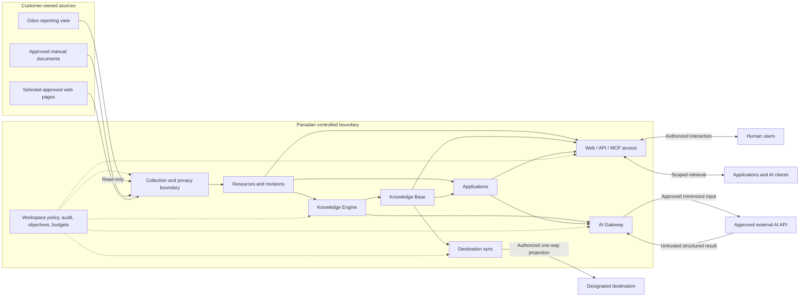
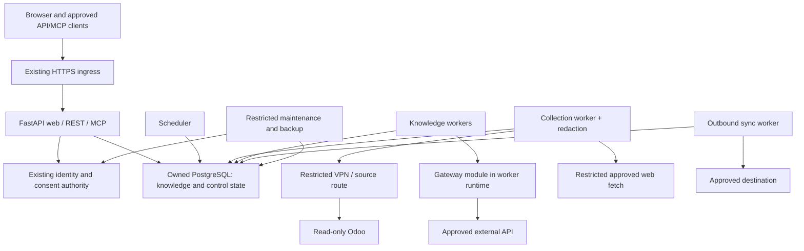
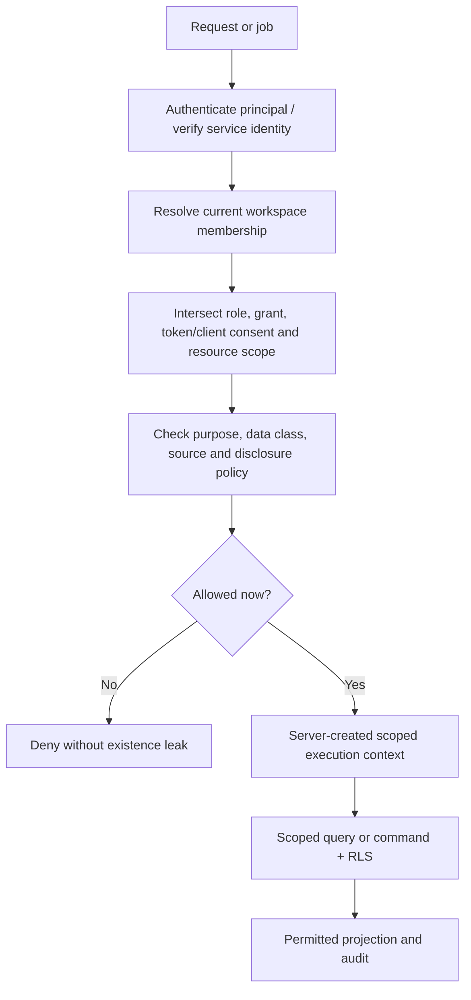
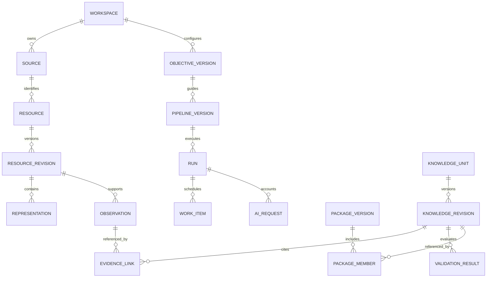
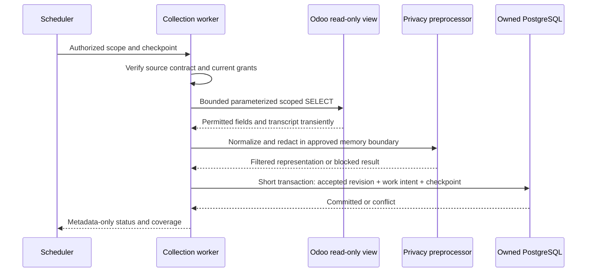
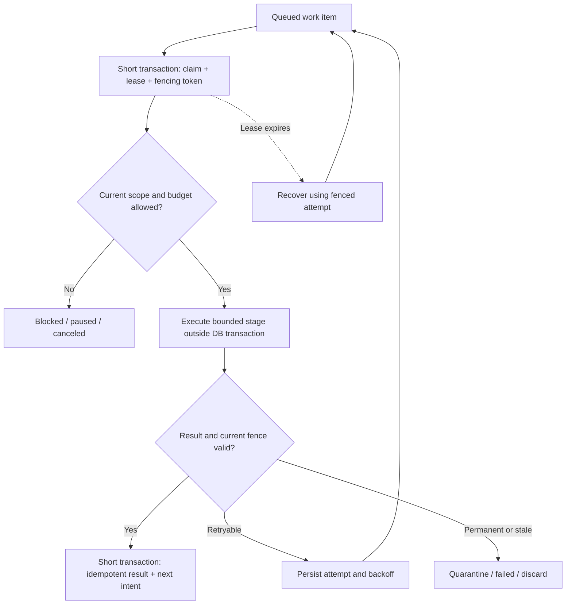
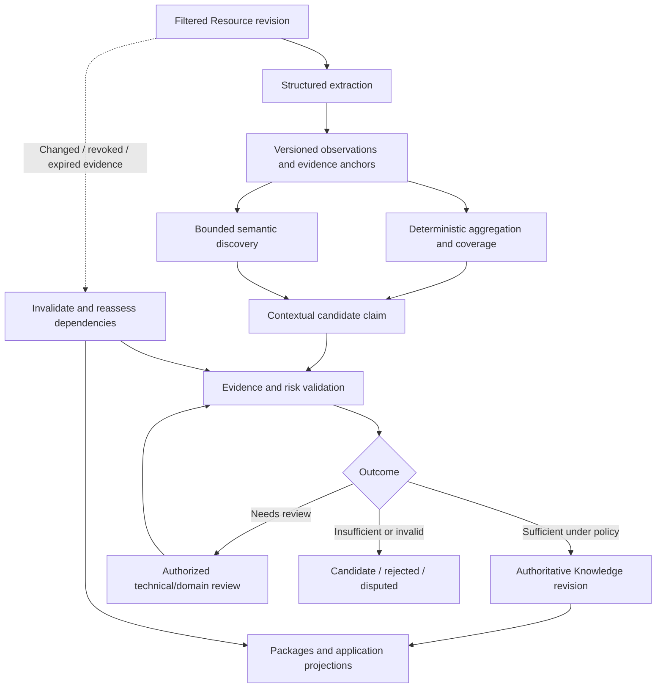
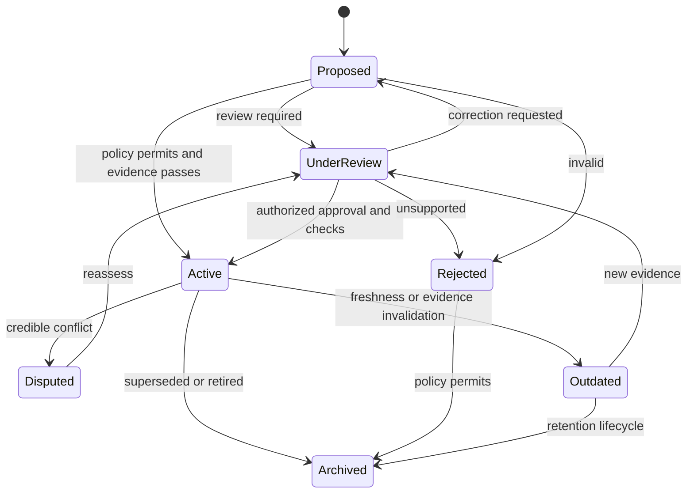
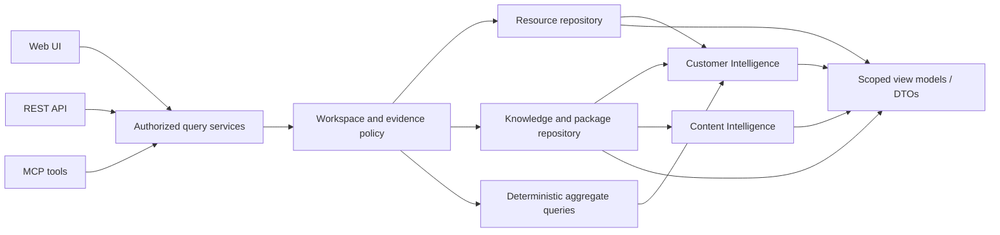
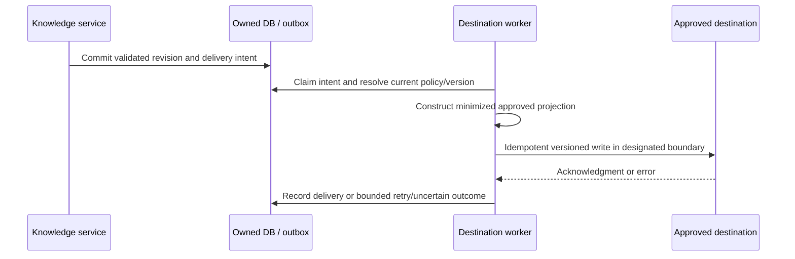

# Panadan Knowledge Platform — System Architecture

| Document | Value |
| --- | --- |
| Version | 0.1 — Phase 5 review draft |
| Date | 2026-11-26 |
| Status | Proposed architecture; awaiting owner approval |
| Approved product scope | [PRD.md](PRD.md), original draft commit 0ed3baf46534f0ff656bf321eda555d2cf9d1054; phase approval recorded at d5af59d4d41d9257668a6e8126db466176415f28 |
| Decision register | [DECISIONS.md](DECISIONS.md), D-001–D-046, 44 public accepted entries |
| Evidence | [CURRENT_STATE.md](CURRENT_STATE.md), [GAP_ANALYSIS.md](GAP_ANALYSIS.md), static inspection of code at approved PRD baseline |
| Branch | feature/knowledge-platform |
| Next phase | DATA_MODEL.md, after architecture approval |

## 1. Intent, assumptions and status

Panadan evolves an existing read-only reporting, REST and MCP service into shared organizational knowledge infrastructure. The architecture below is a proposed technical realization of the approved product scope, not a claim of implementation, an approved production topology, a migration command or authorization for real data. Preserve [AGENTS.md](../../AGENTS.md), [SECURITY.md](../SECURITY.md), [READ_ONLY.md](../READ_ONLY.md), [DATA_DICTIONARY.md](../DATA_DICTIONARY.md), [STATUS.md](../STATUS.md), [PRODUCTION_OPERATIONS.md](../PRODUCTION_OPERATIONS.md), and existing operational constraints. The audit and gap analysis are historical snapshots.

The MVP product and real-data pilot are distinct. The pilot is one designated organization, one authorized call-center operator and the most recent 30 days of eligible history (D-040/044). The platform supports progressive ingestion, manual resources and limited approved web collection, both selected applications, packages, scoped API/MCP and a minimal one-way destination contract. Test unapproved sources/destinations using synthetic fixtures. No automatic scope expansion.

The architecture favors a modular monolith and separate worker processes from the same Python codebase. PostgreSQL is the proposed durable platform state and queue foundation. This is a reviewable technical choice, not an accepted new decision ID. Exact table definitions, SQL indexes, migration numbering, API names, field contracts and final state enums belong to Phase 6 and later design/test reviews. Exact provider, gateway reuse, role assignments, data policy and runtime topology remain conditional.

## 2. Evidence and reuse strategy

The static baseline is Python 3.13, uv/locked dependencies, FastAPI/Uvicorn, Jinja2, JavaScript/esbuild, psycopg 3, MCP SDK 2 and PyJWT. An optional Panadan-owned PostgreSQL 18.6 stack is defined independently of source Odoo and SQLite auth. Production selection of PostgreSQL auth is not supported by the existing staging-only selector. These are facts about repository code and documented configuration, not proof of what currently runs on a live host.

| Existing area / evidence | Proposed disposition | Main risk or required adaptation |
| --- | --- | --- |
| server/main.py, UI/templates, static assets, current reporting routes | Reuse and extend | Add workspace-aware feature surface; preserve old contracts, RTL and legacy access boundaries. Do not expose global reports to new tenant members. |
| server/database.py, tests/test_database_read_only.py | Reuse patterns, extend dedicated scoped reader | Fixed allowlisted view and explicit read-only transactions; verify effective source grants and TLS; existing name filters and ID-only lookups are not authorization. |
| server/odoo_sync_adapter.py, odoo_sync_coordinator.py, odoo_sync_pilot.py | Extend source adapter contract; reuse keyset/checkpoint concepts | Existing adapter has fixed fields and global source keys; verify operator/time/identity and revision semantics. Do not pass broader payloads into knowledge ingestion. |
| server/platform_ingest.py, migration 001_multisource_foundation.sql, tests/test_platform_ingest.py | Refactor/extend through additive isolation | Existing source namespaces, raw revisions and jobs are not tenant-aware. Raw revision history cannot store unredacted pilot transcripts. Preserve legacy data; no blind backfill. |
| server/platform_processing.py | Reuse deterministic transformation concepts | Existing SKIP LOCKED processor does work within a DB transaction; network AI calls require short claim/finalize transactions, leases and failure persistence. Facts are not Knowledge. |
| server/transcript_ai.py and excerpt endpoint | Reuse reviewed masking rules where appropriate, extend distinct pipeline policy | Current fixed-width excerpt masking is best-effort, bounded and offset-based; it is not anonymization or a bulk preprocessing contract. Preserve legacy excerpt offsets. |
| server/security.py, field_permissions.py, permission_catalog.py, auth_store.py, security_pg.py | Extend authorization; preserve one identity authority | Role fallback on malformed grants and legacy NULL defaults need fail-closed handling for new capabilities. Existing SQLite default; PG auth only disposable staging. No silent cutover. |
| server/oauth_mcp.py, oauth_discovery.py, mcp_tools.py | Reuse verified transport/token/consent patterns, extend scoped tool contracts | Authentication, consent, local grants and workspace/egress permissions are separate. Test actual client connection and revocation; no raw transcript tool expansion by default. |
| compose.platform.yaml, database/permissions, deployment scripts, CI/tests | Reuse ownership/network separation and locked build | Owned DB optional and isolated; migrations additive; runtime roles not owners; guarded deploy and private overlays remain authoritative until verified. |
| Objectives, knowledge, validation, taxonomy, packages, apps, AI gateway, outbound connector | Build missing logical modules | Assess existing separately available AI API gateway first; no new vendor or production credentials assumed. |

No baseline component is marked Remove. Existing data, auth, source access and production behavior are not changed by this document.

## 3. Architecture drivers and proposed choices

| Proposal | Choice for initial design | Reason / reconsideration trigger |
| --- | --- | --- |
| AP-01 | Modular monolith: shared Python services, HTTP/MCP entrypoints and independently scalable workers | Reuse existing stack; low operational overhead. Split a service only for measured scaling, isolation or failure needs. |
| AP-02 | Panadan-owned PostgreSQL 18-compatible relational state with typed JSONB extensions and PostgreSQL-backed durable jobs | Existing database foundation, transactional consistency, versioned queries. No Redis/broker, graph/vector DB or object storage dependency initially; add only if evidence requires. |
| AP-03 | Keep existing identity authority for first increment; store new workspace domain grants in one authoritative platform policy store, with an explicit identity bridge | Avoid risky auth migration. If existing identity/consent semantics cannot meet isolation/revocation requirements, block activation and review a single-authority migration. |
| AP-04 | Shared schema, tenant-scoped keys/foreign keys and defense-in-depth RLS on tenant data, with narrow runtime roles | Configuration over custom forks; deny cross-tenant reads/writes. Exact schema/RLS policy reviewed in Phase 6. |
| AP-05 | Call redaction before any durable knowledge-path persistence, and a separately governed source-reader process | Prevent original transcript persistence via generic raw ingest or job payloads. No direct source DB access from AI workers. |
| AP-06 | Deterministic orchestration with explicit versioned tasks, leased jobs, transactional effects and bounded retries | At-least-once processing, not false exactly-once promises; safe replay and auditable cost. |
| AP-07 | Relational evidence/revision links, structured extraction and bounded semantic grouping; no graph/ontology or speculative embedding infrastructure | Exact counts and inspectable provenance first. Reassess retrieval/semantic indexing after measured workloads. |
| AP-08 | Explicit provider/model/credential resolution and transactional budget admission before AI dispatch | Honor D-020/038/039/045. Existing AI gateway may implement adapter capabilities if verified; no direct provider calls from feature modules. |
| AP-09 | Shared authorized query services for Web/API/MCP; separate read-only resource and knowledge contracts | Consistent metrics and permissions without unrestricted SQL or app-specific silos. |
| AP-10 | Separate outbound sync worker and narrowly authorized destination adapter, with durable outbox | Preserve source read-only and customer-owned originals; protect against replay/out-of-order delivery. |

AP identifiers identify proposed architecture choices, not new canonical decisions. Approval or material revision must be recorded through the decision maintenance protocol. No technical choice supersedes an accepted requirement without owner approval.

## 4. System context and trust boundaries



| Boundary | Trust rule |
| --- | --- |
| TB-01 Source → collection | Source is independently owned, read-only to Panadan; records and embedded text untrusted; identity, fields, operator and time scope verified. |
| TB-02 Raw → filtered | Unredacted call text only transiently handled in approved reader/preprocessor; filtered data still sensitive. No raw persistence or default raw egress. |
| TB-03 Tenant → tenant | Tenant-owned entities isolated at application and database layers; explicit shared projection is the only permitted cross-workspace access. |
| TB-04 Panadan → AI | Per-request policy, minimization, provider/model/intermediary allowlist, bounded cost and approved data-purpose/retention terms; provider result untrusted. |
| TB-05 User/client → API/MCP | Authenticate, resolve current membership, intersect token/client/tool/data scopes, authorize before read; no automatic disclosure due to OAuth success. |
| TB-06 Panadan → destination | Separate credentials/adapter and authorized write contract; no source write and no mutation of unrelated customer-owned records. |
| TB-07 Runtime → operations | Separate privileged maintenance from web/worker roles, encrypted backups, secret management, restricted networks and no sensitive logs. |

## 5. Deployment topology and modular boundaries

Target topology, subject to verified infrastructure and reviewed overlays:



The gateway is a logical module, not a mandatory separate network service. Only the appropriate worker runtime receives managed AI credentials; use a verified existing gateway via a narrow adapter if it satisfies all admission/disclosure controls. HTTP requests do not perform long model calls or wait for entire ingestion. The scheduler enqueues; workers claim from owned DB. Source worker has source read-only credential and limited filtered-ingest privileges, not external AI credentials. Knowledge workers have no source write/read credential. Outbound worker has no source credentials and receives only authorized projection. Legacy reporting remains on existing approved access path; new workspace users cannot inherit its global data scope. Separate DB connections/roles, network rules and process environments; no publicly exposed database or internal worker API. Keep existing shared ingress/Plane safety requirements.

### 5.1 Logical module responsibilities

Suggested code organization under the existing backend (names illustrative, not final file layout):

| Module | Responsibility / owned operations | Cannot do |
| --- | --- | --- |
| identity_adapter | Resolve authenticated stable principal; legacy session/token/consent adapter | Grant tenant access from token or email alone |
| workspace_policy | Membership, role templates, grants, authorization, sharing, policy revisions, scope resolution | Read unrestricted payloads for convenience |
| source_registry | Approved connection refs, scope, field allowlists, source contract, health and sync state | Expose credentials or accept arbitrary SQL |
| collection | Read-only adapter, bounded source selection, normalization, redaction, checkpoint reconciliation | Store unredacted call text; write source |
| resources | Logical items, representation/revision registry, typed attributes, scoped lookup | Treat source analysis as independent fact |
| objectives | Template and instance versions, schema/context/validation definitions | Autonomous objective creation |
| orchestration | Pipeline versions, schedule, run/task/lease, retry, coverage and cancellation | Bypass budget or authorization |
| observations | Structured extraction, validated evidence anchors, compatible result reuse | Publish authoritative claims |
| knowledge | Candidate grouping, exact aggregation, contextual units, lifecycle and provenance | Approve unsupported claims |
| validation | Versioned deterministic rules, bounded AI assist, review, conflict/freshness checks | Single opaque trust score |
| taxonomy | Stable categories/versions, suggestion workflow and mapping | Autonomous official taxonomy mutation |
| packages | Versioned collections, policy-aware sharing/projection | Elevate member access |
| ai_gateway | Explicit provider adapter, egress policy, request ledger and budgets | Accept arbitrary endpoints or disclose unapproved data |
| applications | Configured Customer/Content Intelligence, common query service and brief generation | Independent evidence silo or automatic publishing |
| access | Web/API/MCP DTOs, pagination, authorization mapping, read services | Direct arbitrary SQL or broad raw transcript export |
| distribution | Approved projection/outbox, versioned destination write and reconciliation | Mutate source or unrelated destination records |
| operations | Metadata audit, health, retention, backups and controlled maintenance | Use logs as data storage |

Dependency direction: transport adapters → application services → domain policy/services → narrow repositories/ports. Domain logic is not embedded in HTML routes, MCP handlers or provider adapters. Shared contracts carry tenant, policy and provenance. Cross-module changes use explicit service operations, not arbitrary writes into each other's state. Internal module calls need no network hop. Deterministic domain logic stays testable without DB or provider where possible.

## 6. Workspace, identity and authorization design

### 6.1 Single identity authority and legacy bridge

Retain the audited existing identity backend for first increment (SQLite is current default; PostgreSQL auth selector is staging-only). Proposed bridge maps authenticated immutable internal account identity (and verified external issuer/subject where applicable) to a stable platform principal. Do not bind accounts by unverified email, display name, operator name or client-supplied tenant ID. New platform membership and workspace grants have one authoritative store in owned PostgreSQL, not duplicated role decisions in SQLite and PostgreSQL. Existing auth authority continues to decide authentication, session/token validity and MCP local consent. New tenant authorization depends on both layers.

This split is not an authorization cache: each request/dispatch rechecks current auth and policy. No cross-database atomic transaction is assumed. Use policy revisions, short-lived operation context and explicit fail-closed checks at sensitive boundaries; design revocation race tests. If the bridge cannot satisfy required revocation/availability, disable new access and review a single-authority migration, not parallel login systems. Do not enable the staging PG auth backend in production. Legacy reporting access must be explicitly restricted to existing approved principals/scope; new membership must not automatically create legacy reporting privileges. Review legacy globally scoped user/session/token behavior before tenant activation.



### 6.2 Effective policy and tenant data

A proposed authorization input is AuthContext(principal_id, workspace_id, channel, authenticated_session_or_client, permitted_capabilities, policy_revision, source/operator scope, allowed data classes, purpose). It is assembled server-side from verified facts; external workspace selection is a request, not proof. Grants are intersections, never unions that expand delegation. Explicitly distinguish access to resource, representation, evidence excerpt, validated knowledge, review candidate, package, execution, cost and external disclosure. Source read permission is not processing or external disclosure permission. Role names and permission strings to be finalized in Phase 6.

Data access defaults to tenant predicate plus least-privilege role and RLS on tenant-owned tables. Use tenant-scoped unique keys and composite FKs to reject cross-tenant references at the DB level. Proposed PostgreSQL pattern: transaction-local trusted workspace context, set only by backend after policy resolution; pooled connections never retain context across transactions; missing context denies. Table owner and migration/maintenance roles separate from runtime; enforce RLS appropriately and test owner/BYPASSRLS/SECURITY DEFINER paths. RLS protects against missing predicates, not compromised unrestricted SQL or arbitrary trusted context selection; no direct client SQL or user-controlled context setting. Background jobs use explicit scoped service context, not a global worker superuser. Job claim across tenants requires a narrow scheduler/dispatch mechanism returning metadata, then scoped processing. Choose exact isolation mechanism and privileged queue functions only after threat model and Phase 6 review.

Sharing uses explicitly authorized projection or grants referencing permitted knowledge, not cross-tenant access to original resource tables. A package cannot grant implicit access to a restricted unit or evidence. Default private; revocation suppresses further authorized retrieval; validate recipient and purpose. Do not claim revocation deletes external copies already received.

### 6.3 Source/operator boundary

Use verified immutable source-backed operator identity and assignment semantics, not display-name filters. Current data dictionary candidate numeric operator field and sample agreement are not proof of stable scope. A trusted adapter must select only authorized fields and operator/time population using parameterized SQL; verify mapping, ambiguous assignments and missing dates. Require explicit effective DB read-only privileges and review source query plans/timeouts. Local source identity is scoped by workspace + source + verified external ID. Enforce boundary on selection, ingestion, processing, aggregates, evidence, API and MCP; no widening due to smaller sample. Exact call date meaning and timezone must be confirmed before real use.

### 6.4 Revocation and access changes

Recheck current grants before reading payload, provider dispatch, durable result publication and outbound transmission. A policy change invalidates stale cached projections, disables new jobs and causes affected queued work to pause or cancel; already transmitted requests cannot be recalled. In-flight results are rechecked before persistence/distribution and may be quarantined or discarded under retention policy. Record outcome and policy version; never imply revocation can undo external disclosures. For strict races, serialize authorization-changing writes and sensitive admission where feasible and define explicit in-flight semantics. No holding database locks over external network calls.

## 7. Logical data architecture and contracts

Owned PostgreSQL is the proposed canonical store for workspace control and derived knowledge state. Use normalized relational keys and typed JSONB for versioned, validated extensions rather than untyped universal blobs. This is a logical model, not table DDL.

| Aggregate / logical record | Identity and contents | Lifecycle / invariants |
| --- | --- | --- |
| Workspace, PrincipalRef, Membership, Grant | Stable IDs, tenant scope, role/capability/data policy, revisions | One current authority, explicit revocation, no implicit tenant-wide content access |
| Source, SourcePolicy, SyncCheckpoint, SyncRun | Tenant/source/stream, adapter/contract version, permitted fields/scope, cursor | Advance checkpoint only after durable accepted local outcome; separate source sync and extraction coverage |
| Resource, ResourceRevision, Representation | Tenant/source/external ID, source marker, local immutable revision, permitted representations/context, policy | Originals remain at source for calls; no durable raw unredacted representation; current pointer monotonic under verified source ordering |
| ObjectiveTemplate, ObjectiveVersion, PipelineVersion | Purpose, input/output schema, typed context and validation; task/model/schedule/scope version | Immutable published configuration; activation authorized; runtime rechecks current grants |
| Run, WorkItem, Attempt, CoverageSnapshot | Tenant/scope/manifest, stage, lease/fence, idempotency identity, outcome, budget refs | Durable attempts, bounded retries, replay-safe effects; unknown completeness represented |
| ObservationSet, Observation, EvidenceAnchor | Resource revision, compatible extraction signature, structured facts/mentions, permitted span/locator | An observation is not authoritative knowledge; incompatible or stale results not reused |
| KnowledgeUnit, KnowledgeRevision, EvidenceLink, ValidationResult, ReviewAction | Contextual claim, time, population, supporting/counter evidence, policy, reviewer and versions | Active pointer only to valid approved revision; state/history auditable subject to retention |
| TaxonomyVersion, Category, CategorySuggestion | Stable IDs, parent/category mapping, evidence and status | Suggestions separate; version-aware classification, no implicit historical reinterpretation |
| KnowledgePackage, PackageVersion, PackageMember, ShareGrant | Versioned references, inclusion policy, permitted consumer | Membership does not elevate access, stale/revoked unit checked on read |
| ApplicationConfig, InsightProjection, ContentOpportunity, Brief | Authorized objective/query, selected knowledge/evidence refs, versions and scope | Derived projections not independent truth; invalidate if inputs or policy change |
| ProviderConfigRef, AIRequest, BudgetAccount, Reservation, UsageEntry | Tenant/run/pipeline, approved model, estimate/actual, status and rate version | Secrets referenced not exposed; atomic admission and reconciliation; uncertain spend retained |
| Destination, Projection, OutboxDelivery | Tenant/destination, unit/version, approved payload contract, delivery identity | Idempotent/version-aware; never modifies unrelated customer-owned records |
| AuditEvent, RetentionTask | Actor/operation/target ID/status/policy, bounded metadata | No transcripts/secrets; access controlled; sensitive audit durable, purge/restore reviewed |



The diagram omits policy, audit and many relationship details for readability. Every tenant-owned edge must be workspace-consistent. Exact cardinalities, shared templates vs tenant instances, effective grant structures, indexes and retention FK actions belong to Phase 6.

### 7.1 Versioning and identity

Use stable logical IDs with appendable revisions and explicit current pointers. A representation revision binds source revision, normalization/redaction version and authorized schema. Evidence anchor references a filtered representation revision and bounded span or structured locator, not mutable text or raw offset unless separately verified. For typed placeholders that change length, do not claim original offsets are preserved; maintain filtered offsets or approved mapping without retaining raw identifiers. Current pointers and invalidation change transactionally. Version history is not an exemption from retention: deleted/expired payloads may become inaccessible with minimal permitted tombstones, not recoverable copies. Hashes of sensitive content/low-entropy fields can themselves be sensitive; avoid unnecessary raw hashes and keep any required deduplication identifiers within authorized scope.

Versioned extraction signature should include workspace, resource/representation revision, semantic task and schema version, normalization/redaction policy version, model/provider/config version and compatible purpose/policy context. Reuse only if current policy, meaning, source freshness and coverage permit. Do not use shared cache across tenants. Candidate/revision identity is not merely text equality: subject, claim type, comparable conditions and temporal scope matter. Exact canonicalization, hash strategy and invalidation dependency model are design work.

## 8. Collection, synchronization and privacy pipeline



### 8.1 Source adapter contract

Proposed logical interface: describe_contract(), validate_scope(), preview_metadata(), read_page(scope, cursor, bounded_limit), normalize(), detect_changes(), reconcile(). An adapter returns a bounded batch of source-backed stable identities, known version markers, permitted fields, provenance and cursor semantics; the collection layer returns only sanitized/approved representations to persistence. Treat source payloads as untrusted. Never implement arbitrary SQL query input. Connector config is versioned, disabled by default, verified on activation. Source reader timeouts, bounded concurrency, backpressure and health are explicit.

For Odoo, use fixed view and a dedicated narrow reader query (not the existing broad reporting payload or raw revision ingest blindly). Existing ID stream and timestamp+ID update keyset with settle/overlap are reusable concepts. Confirm stable unique IDs, actual call time semantics, write marker/clock mode, joined-field updates, assignments and delete signals. Current legacy adapter may not cover all updates/deletions and raw revisions may contain more fields than permitted. Establish the approved source contract before choosing exact keysets.

For initial history, seed a verified update watermark before bounded backfill, freeze 30-day population bounds and use stable cursor; process overlapping updates with version comparison and idempotency. Keep source sync and extraction coverage separate. Use deterministic tie-breakers and reject ambiguous older/conflicting events; if source markers cannot order revisions, quarantine/reconcile rather than overwriting newer content. Advance a checkpoint only with committed filtered revision/work intent or explicit policy-defined terminal exclusion status; ambiguous failures remain visible. Avoid long-lived source transactions/locks; read-only source connection separated from owned DB. A checkpoint is not proof of full source history or deletion completeness. No inferred source deletion from missing page, date shift or changed filter. Confirm supported tombstone or authorized reconciliation contract. When resource moves outside approved scope, suppress and reconcile local data per policy, not mutate source.

### 8.2 Redaction and storage

Process unredacted call text only in approved transient memory. Do not write it to generic raw revision history, durable queue, temporary file, dead-letter, cache, provider telemetry, logs, exception payload, backup or crash dump. Configure runtime diagnostics/core dumps/swap and review transient handling accordingly; if required guarantees cannot be achieved, block live execution. Apply bounded deterministic rules and typed placeholders; normalize digits and common variants as appropriate, test Persian, Arabic-digit and mixed-language patterns, split boundaries and false positives affecting prices/meaning. Existing excerpt mask has different offset semantics; preserve that contract and reuse only tested rules. Avoid claiming detection of all names, addresses or indirect identifiers. Require data classification and approved residual-risk policy; suspected unsupported sensitive content is blocked or reviewed within authorized boundary. No AI semantic redaction in MVP. Never re-transcribe or fetch audio for this pilot.

Persist approved filtered representation, allowed metadata, source/revision refs and policy version only. Store derived observations/knowledge separately. Source-owned original remains untouched. Data retention and deletion apply to local versions, indexes, cached projections, task payloads, audit metadata and backups according to approved policy. Reconcile source-owned changes or revocation by suppressing stale data and re-evaluating dependencies. Document what cannot be recovered or deleted from external systems.

### 8.3 Other MVP inputs

Manual text and limited approved document types: authenticated upload, size/type/content validation, isolated parser with no active content execution/network, bounded output, provenance and permissions; reject encrypted/unsupported/unsafe files unless reviewed. Use owned DB for bounded text and metadata initially; attachment/blob strategy remains Phase 6 choice based on approved formats and sizes. No general arbitrary document archive dependency. Approved web pages: exact allowlist, URL canonicalization, DNS/IP and redirect checks on each hop, block loopback/private/link-local/metadata targets except separately authorized explicit internal connectors, TLS, bounded response/time/size, no arbitrary crawl, no active scripts by default, source rights and freshness. Use restricted egress, not URL parameters passed to the provider. Treat retrieved content as data, not instructions. Synthetic fixtures until authorization.

## 9. Orchestration, scheduling and reliable execution

The proposed scheduler persists schedule occurrence IDs and scoped run manifests. Each run pins objective, pipeline, source scope/window, taxonomy/schema/redaction/validation versions, provider/model and budget configuration; current authorization is rechecked independently. Work items carry references, never raw transcript payloads. Use separate queues or priority classes for fresh increments, historical backfill, validation and outbound delivery; bounded fair scheduling avoids starvation. Workers may scale independently. No external message broker required for MVP unless measured needs warrant it.



Proposed state semantics (not final enums):

| State | Meaning / allowed next step |
| --- | --- |
| queued | Ready for authorized bounded claim |
| running | Active leased attempt; heartbeat/expiry metadata only |
| retry_wait | Classified transient failure, next eligible time, bounded attempt count |
| blocked_policy / blocked_budget | No new effect allowed; explicit approval/config change and recheck required |
| paused | User/scheduler requested no new work; define in-flight completion semantics |
| succeeded | Durable accepted result recorded; replay returns existing compatible effect |
| failed / quarantined | Permanent or exhausted failure; explicit reviewed retry/new version only |
| canceled | Stop future work; already committed effects handled by policy |
| partial (run level) | Some work succeeded, some failed/pending/excluded; no false complete coverage |

Claim transaction uses row lock/SKIP LOCKED or equivalent narrow mechanism, commits lease/fencing before network. On completion check current fence, task identity and policy, persist idempotent effect and next-stage intent in same transaction. Expired leases recover; old workers cannot overwrite new results. Use monotonic fencing, bounded heartbeats, retry backoff/jitter, attempt counters, error classification and operational visibility. Do not hold a SQL transaction open during provider request, source fetch or outbound call. An external API can accept a request while local result is lost; distinguish uncertain outcome, retain cost reservation and reconcile before retry, use provider idempotency where supported. At-least-once attempts, idempotent local effects; no exactly-once external guarantee. Deterministic unique identities for schedule occurrence, resource revision/extraction signature, result and publication/outbox prevent double counts and duplicate work. Crash between local commit and external acknowledgement is explicitly tested.

Run progress derives from persisted item outcomes and eligible population snapshots. Report eligible, attempted, successful, failed, excluded, pending, unknown; separate collection, redaction, extraction, validation and distribution coverage. Late updates or changed policy invalidate affected outputs; rerun scoped dependencies, not entire history by default. Pause/resume preserves committed work. Cancellation/revocation does not undo external charges; retain minimal audit and apply policy to in-flight outputs.

## 10. Knowledge Engine: extraction, aggregation and validation



### 10.1 Objective execution

Objective template defines purpose and expected semantic categories/output, typed context, source scope and validation requirements. Pipeline version chooses approved model/task, schedule, scope and budget. Extract compatible source-level observation sets once where feasible; reuse across the first six customer objectives with explicit compatibility, not forced universal schema or seven model calls per transcript. The seventh Content Opportunities objective operates on authorized validated knowledge. Custom objectives use bounded structured configuration, not arbitrary code or prompt/tool authority. No automatic objective/pipeline creation.

| Objective | Extraction/aggregation architecture | Constraint |
| --- | --- | --- |
| Customer Questions | Extract actual questions, normalize topic, count distinct calls, link anchors | Question does not prove answer or search volume |
| Needs & Preferences | Typed expressed needs and context, group by permitted dimensions | Explicit vs inferred; no individual profiling |
| Customer Concerns | Concern and subject/context, semantic grouping and deterministic prevalence | Concern not verified event |
| Purchase Barriers | Stated obstacle and verified stage/outcome if available | No causal/paid-sale inference from upstream AI labels |
| Destination Intelligence | Destination mention, intent/question and conditions | No market demand inference |
| Price Sensitivity | Budget/quote/reaction distinction; currency, basis, conditions, scope | No current quote without fresh resource; unknown not conflict |
| Content Opportunities | Derive topic/brief from validated relevant knowledge and permitted evidence | Not independent factual knowledge or SEO volume |

Proposed typed structured response envelope: schema_version, observation_kind, subject, value/claim, speaker attribution or unknown, conditions, source revision/representation ref supplied by trusted task, evidence anchor(s) in allowed text, uncertainty, category candidate. Provider cannot choose trusted IDs/scope or grant itself authority; validate type, length, enums, allowed references, evidence offsets/excerpts against actual filtered input and semantic relevance. Reject fabricated refs and unsupported statements. Preserve distinction between observed speaker statements and external facts. Truncation/chunking limits must be explicit; if a call exceeds supported length, use bounded chunk plan and dedup across overlaps or mark partial rather than silently dropping context. Exact structured schema, reference matching and tokenization strategy Phase 6.

### 10.2 Aggregation

Use SQL/code for exact distinct-call counts, populations, measured denominators, overlap, time bins, deduplication and coverage. AI may suggest semantic equivalence/clusters or new topics in bounded scope, but deterministic code owns counted membership. Version the membership and aggregation parameters so a result can be reproduced given retained permitted evidence. Distinguish prevalence among processed calls from coverage of eligible population. If total unknown, mark unknown; do not estimate without approved method. Multiple mentions/categories can overlap; count distinct eligible records for call prevalence, not people. Do not compare different windows/taxonomy revisions without explicit comparability. Rare finding may be useful but not broad claim.

### 10.3 Validation and knowledge lifecycle

Candidate claims become independently versioned Knowledge only when policy allows. Evaluate reliability (source authority by subject, evidence independence and quality, conflicts, contextual/time alignment, freshness), prevalence (count, denominator, coverage) and importance (business relevance) separately. No universal composite score or fixed minimum count across all claims. Upstream AI and transcript are correlated; not independent corroboration. Policy may automatically validate low-risk sufficient findings; uncertain/high-risk/sensitive claims require authorized human review. Human review cannot override hard access/privacy or missing evidence. Record rule version, result/reason, reviewer and rationale. Claims with different travel dates, room types, traveler counts, inclusions, currency or quote validity may be compatible; unknown conditions not automatic contradiction. Current price/bookings remain Resources. Never promote a draft to authoritative knowledge merely because it is fluent.



This is a proposed conceptual lifecycle, not a final enum/transition matrix. A corrected/superseding claim creates a new revision; transitions and review events must not rewrite past content. Only an active, policy-validated and currently permitted revision is eligible as authoritative. Retention may remove payload/history with permitted tombstones. Disputed/outdated/revoked or missing evidence suppresses authoritative projections immediately when known; recomputation/review may be asynchronous. Exact policy freshness checks and risk rules remain open O-07.

Taxonomy changes are versioned suggestions, review and accepted mappings. Separate stable category IDs and labels; unknown/unmatched allowed. Merge/reclassification is a reviewed versioned operation with reproducible historical reporting. Packages reference unit revisions and version policy; no duplication of uncontrolled text or widened access. Recheck member validity, current grants and evidence at retrieval, rather than trusting cached package content.

## 11. AI Gateway: provider integration and budget accounting

All semantic extraction, bounded matching/validation assist, opportunity and brief generation use a common gateway contract. Proposed call input: trusted workspace, task/run/attempt, purpose, permitted representation references, provider/model config version, output schema, bounded token/time/step limits, applicable budget and policy versions. Gateway resolves approved credentials server-side and assembles minimal allowed input from scoped resources. It never accepts arbitrary URL, client-supplied provider secret or raw source connection. Evaluate reuse of existing organizational AI API infrastructure: model/provider allowlist and actual downstream recipient, retention/training terms, structured outputs, usage/cost provenance, timeout/idempotency and credential isolation. If intermediary cannot attest required terms or enforce controls, block that route. Provider not selected. BYOK, self-hosted and intelligent routing deferred.

```mermaid
sequenceDiagram
    participant W as Knowledge worker
    participant G as AI Gateway
    participant A as Policy service
    participant B as Budget ledger
    participant P as Approved provider
    W->>G: Scoped task and approved input refs
    G->>A: Check current scope, purpose, provider and data policy
    A-->>G: Decision and policy revision
    alt Policy denies
        G-->>W: Blocked policy; no dispatch
    else Policy allows
        G->>B: Atomically reserve org and run capacity
        B-->>G: Admission result
        alt Budget denies
            G-->>W: Blocked budget; no dispatch
        else Reserved
            G->>A: Recheck before egress
            alt Scope or policy revoked
                G->>B: Release verified unused reservation
                G-->>W: Blocked policy; no dispatch
            else Still authorized
                G->>P: Bounded minimized request
                P-->>G: Result, reported usage or uncertain outcome
                G->>B: Reconcile actuals or retain uncertain reservation
                G->>G: Validate schema and evidence anchors
                G-->>W: Accepted result or classified failure
            end
        end
    end
```

No dispatch after deny or budget block. For each chargeable attempt, reserve a conservative upper estimate against both organization and execution budgets in one transaction using consistent lock ordering or equivalent atomic ledger constraint. Proposed admission condition: committed spend + pending/uncertain reservations + new upper estimate must fit each applicable cap. Calculate with verified rate/version, token/input/output limits, fees and currency rules; if cost cannot be safely bounded, fail closed. Retry is a new chargeable attempt with separate reservation unless verified idempotent. Actuals reconcile independently of semantic success; a failed result may still cost money. Timeout with possible provider acceptance remains uncertain, not zero spend; do not free reservation blindly. Handle reconciliation idempotently; release only when verified. If actual exceeds estimate, record discrepancy, block new requests where appropriate and alert; local admission limit cannot guarantee provider invoice exactness. Ledger immutable adjustments with authorized budget version changes; exact currency/precision/reset and rate source Phase 6. No billing/wallet or advanced pipeline/app quota. Pipeline attribution is reporting.

Provider outputs never control tools or authorization. Treat prompts/source text as untrusted content; fixed task instructions, explicit output schema, minimal context, no arbitrary tool use or network. Bound retries, input/output size, time and concurrency; sanitize errors and observability. Model selection explicit; fallback only if independently approved and within same data/budget policy. No sensitive prompt/response logs, secrets or raw text in request ledgers. External clients via MCP have separate disclosure policy; their own generation cost is not automatically measured by Panadan unless specifically integrated and approved.

## 12. Application and query architecture



Use shared query/read-model services for all transports, with explicit workspace, source, population, time, objective/taxonomy and allowed fields. No client-supplied SQL; fixed query vocabulary, parameterized statements, bounded limits, cursor pagination, stable sort, timeouts and evidence projection. Derive counts from same population/definition, not independent UI/API metrics. Scoped caching only if necessary, with policy/revision/freshness keys and invalidation; no shared tenant cache. Start with relational search/filter and indexed query patterns; evaluate text/semantic search later with language relevance and access tests, not a speculative vector dependency.

Customer Intelligence: aggregate views and insight feed reference active knowledge, evidence and coverage. Return typed scope, denominator, measure definition, version and partial/stale/unknown flags. No unique customer count unless independently verified, no multi-operator comparison in pilot. Content Intelligence: approved opportunity and brief records cite relevant knowledge revisions, intended audience/format/outline, limitations and freshness; regenerate or mark stale when upstream claim changes. Brief generation is governed AI task through gateway, not authoritative claim. Drafting occurs through authorized external MCP clients; no in-panel editor/CMS or auto-publish. Both applications use shared data; application configuration cannot bypass policy. No unrestricted agent actions.

Web: extend existing FastAPI/Jinja/JS shell and RTL experience; architectural interface boundary independent of eventual visual design. Proposed UI areas from PRD are navigational groupings, not enforced routes or aesthetic decisions. Long work returns run ID and status; UI uses bounded polling initially, no real-time infrastructure required until measured. Include permission, error, incomplete/empty, stale, budget-blocked and review states.

### 12.1 API/MCP contracts

Names below are illustrative capabilities to be finalized in Phase 6/design review. Preserve existing /api/v1 reporting and /mcp/ behavior unless an explicitly reviewed additive contract is introduced. Version new knowledge interfaces distinctly, do not silently change old token meanings. DTOs carry opaque logical IDs, revision, context, scope, provenance, current validation/freshness and coverage as allowed. Sensitive representations require independent grant and bounded retrieval.

| Logical capability | Input / output | Policy |
| --- | --- | --- |
| list_resources / get_resource | Scoped filters, cursor, permitted metadata and representation availability/detail | Resource and representation grants |
| search_knowledge / get_knowledge | Scope, objective/topic, pagination; validated claim, allowed evidence links and context | Current validated revision and evidence grant |
| get_package | Package and version ref; permitted member projection | Package grant intersected with member policy |
| query_customer_insights | Approved metric/dimension/window filters; measured counts and coverage | Scoped deterministic query; no SQL |
| list_content_opportunities / get_brief | Scoped filters and revision; brief, outline and permitted evidence | Validated knowledge dependencies and content access |
| review/configure/run | Authorized web/admin commands with version checks, audit and explicit scope | Separate mutation grants; not broad external MCP authority |

MCP uses existing verified Streamable HTTP patterns, OAuth metadata/issuer/audience/scope and client identity verification, local consent plus current membership/grants; actual approved client discovery, consent, invocation, error and revocation tests are mandatory. No reliance on client tool descriptions for authorization. New tools must reject forged tenant/ID, stale grants, unauthorized filters and sensitive evidence. Legacy redacted transcript chunk contract not equivalent to general transcript export or AI processing authorization. Authentication failure and authorization denial do not leak existence; safe rate/size limits and audit. External API and MCP responses share DTO and service policy; no automatic access to raw originals or all tenant knowledge.

## 13. One-way knowledge synchronization



Destination connector is distinct from source adapter; separate credentials, runtime role and approved target contract. Only validated/current permitted knowledge projection can be queued and transmitted. Atomically commit publication plus outbox intent; recheck version, consent, sharing and destination policy on claim and immediately before send. Idempotency identity includes tenant/destination/projection logical ID/revision/operation. Destination must enforce or safely emulate version ordering and idempotency; if target cannot, block or choose reviewed reconciliation contract. Do not permit an old retry to overwrite newer revision. External commit/ack gap handled by idempotent retry or reconciliation, not blind duplicate write. Revocation or invalidation produces approved withdrawal/stale indication according to destination contract; no destructive removal of existing customer-owned records and no promise to recall external copies. Default no live destination; synthetic isolated target to verify. No source credential reused, arbitrary SQL or bidirectional editing. Panadan authoritative for its knowledge lifecycle only.

## 14. Security, privacy and failure model

| Threat / failure | Architectural control | Verification |
| --- | --- | --- |
| Cross-tenant ID, filter, count or evidence leak | Trusted scoped context, tenant predicates/FKs/RLS, narrow projections, explicit sharing | Two synthetic workspaces with overlapping IDs; every entrypoint/worker negative test |
| Source write or accidental broad import | Dedicated verified read-only role, fixed allowlisted SQL and scopes, source network isolation | Effective privilege audit, synthetic source write denial, unchanged source fixtures |
| Raw PII persists in jobs/logs/revisions | Pre-persistence redaction, transient reader, metadata-only status, payload scanning and error sanitization | Synthetic leak canaries across persistence, logs, retries and backup |
| Prompt injection or fabricated evidence | Untrusted input; fixed task, no arbitrary tools; structured schema/evidence matching and review | Adversarial fixtures, invalid references, hallucination tests |
| Unauthorized external disclosure | Policy per provider/client/destination, data minimization, current policy rechecks, approved egress | Mock provider/client deny/no-send assertions, revocation races |
| SSRF/file parser abuse | Restricted fetch network, redirect/DNS/IP checks, bounded parsing, file allowlist | Denied metadata/private URL, redirect, malformed/oversized files |
| Budget bypass or unknown charges | Atomic dual-cap reserve, bounded request, attempt cost ledger, uncertainty | Parallel admission, retries, timeout/reconciliation and missing rate tests |
| Poison job, crash, stale worker | Lease/fence, bounded retry, short tx, idempotent effect/outbox | Crash/replay, stale completion, duplicate schedule and delivery tests |
| Inconsistent source updates/deletions | Verified source contract, overlap/reconcile, scoped revision monotonicity, visible unknown | Late/duplicate update, ambiguous ordering, deletion signal and stale evidence fixture |
| False authoritative claim | Risk policy, independent evidence/context/freshness, review, invalidation | Contradiction vs distinct conditions, expired evidence, unsupported claim |
| Compromised privileged runtime / secrets | Least privilege, isolated processes/networks, no client secrets, guarded maintenance and backup | Role/egress tests, secret scanning, recovery drill |
| Audit outage or stale policy | Durable sensitive audit with effect or fail closed; current policy check | Simulate audit/policy outage; no silent sensitive disclosure |

Use TLS and protected storage appropriate to approved policy; confirm actual DB/source certificate and transport requirements, do not claim existing sslmode=require proves server identity. Secret refs separated by purpose and environment; no credentials in repository/DTO/logs. Security-sensitive actions require durable minimal audit and fail closed if audit cannot be guaranteed. For external disclosure, commit admission/audit intent before dispatch; reconcile outcomes afterward. Audit contains IDs, status, policy, actor and bounded metadata, not text, secrets, prompts or raw provider outputs. Restrict and retain audits under approved policy. No production secrets or real records in tests/public history.

### 14.1 Invalidation and retention

Dependency links from source revision → representation → observations → candidates/knowledge → packages/briefs/projections/outbox enable targeted invalidation. Mark affected authority/projection unavailable synchronously where possible before async recomputation. Retrieval checks current policy and validity even if invalidation jobs lag. A source-owner change/deletion signal is not permission for Panadan to write source. Local retention/purge is separate from immutable revision semantics: remove restricted payloads when required; preserve minimal permitted tombstone/audit only if allowed. Backups need expiry, restricted recovery and post-restore reapplication of deletion/revocation ledger before access; if retention cannot be met, block activation. External provider/destination data handling verified via terms and enforceable contract; do not claim complete external erasure.

## 15. Operations, observability, performance and recovery

Separate liveness from readiness: liveness only process alive; readiness for platform features requires owned DB/schema, compatible policy/identity bridge and necessary local dependencies; source/provider/destination availability separately shown as degraded, not all routes down. Legacy reporting can continue independently if platform disabled or AI budget exhausted. Feature activation default off; source/provider/destination connections individually enabled with approved scope. Metadata-only run events and counters: source sync lag/last success, eligible/processed/failed/pending/unknown, queue age/lease expiry, retries, provider latency/schema failures, estimated/reported/uncertain cost, budget block, validation/review backlog, evidence invalidation, outbox lag, audit/retention failures, backup freshness and restore readiness. No high-cardinality customer identity or content in telemetry. Define operational thresholds after E0/E1 measured data, no invented SLA.

Use bounded batches, timeouts, index-backed keyset pagination and short transactions. Measure p50/p95 latency, throughput, queue age, DB connections/load, provider rate limits, bytes/storage growth and cost per eligible/processed call. Separate fresh and backfill work, backpressure at source/gateway, fair tenant scheduling and concurrency caps. Scale worker count only after tests; avoid excessive source load. Use PostgreSQL connection pooling with transaction-local scope reset; verify pool isolation. Keep migration/backup roles offline from normal runtime. No mandatory Kubernetes, distributed queue or graph DB in MVP.

Recovery plan: approved encrypted independent off-host backups of owned DB and identity store/config with consistent recovery procedure; existing operational evidence is historical, not proof of current automated backup. Test isolated restore with synthetic data, schema version, policy/identity mappings, queue reconciliation, outbox versions, budget uncertain reservations and retention/revocation reapplication before serving. Establish agreed RPO/RTO after measured backup/restore. Source DB backup is customer-owned; Panadan never modifies it. If DB fails, stop affected jobs safely; if source fails, preserve checkpoint and mark stale; if provider fails, bounded retry or blocked; if destination fails, retain intent and reconcile; if policy unavailable, deny. No implicit provider or auth fallback.

## 16. Incremental transition and rollback strategy

Proposed sequencing, not an implementation roadmap or delivery schedule. Full roadmap follows Phase 6/7.

| Transition | Entry / change | Rollback or stop condition |
| --- | --- | --- |
| T0 Baseline | Verify branch, tests, existing auth/reporting contracts and documented runtime; synthetic fixtures only | Stop if baseline regressions or unsafe current privileges; no production change |
| T1 Isolation/control foundation | Add tenant/principal mapping and policy boundaries to owned state; no legacy auto-grants; disabled feature flags | Disable feature; preserve old auth/reporting; no destructive migration |
| T2 Resource path | New scoped adapter/preprocessor and tenant-safe revisions, explicit synthetic import; legacy raw ingestion reviewed but not repurposed blindly | Disable new connector, stop workers; retained data subject to policy; no source writes |
| T3 Execution/AI | Add objective/pipeline versions, durable jobs and mock gateway/budget; synthetic extraction/replay | Pause scheduler/workers, retain/reconcile attempts/reservations; no unapproved provider |
| T4 Knowledge/apps | Add observations, validation, review, taxonomy, packages, shared query/app projections | Hide new surfaces; suppress invalid outputs; preserve evidence history per retention |
| T5 Distribution | Scoped new API/MCP and synthetic destination, verify legacy compatibility | Revoke new scopes, pause outbox, reconcile delivered/uncertain effects |
| T6 Pilot evaluation | Explicit E1+ authorization, single operator/30 days, finite cap, passed safety gates | Stop on policy, quality, privacy, scope or budget violation; no automatic expansion |
| T7 Production release | Separate readiness/security, restore and deployment approval, reviewed controller/overlays | Documented image/config rollback; schema backward compatibility or reviewed restore, no blind destructive downgrade |

Use additive migrations and explicit ownership. Do not edit already-applied baseline migrations; choose new migration plan in Phase 6. Inventory existing owned DB contents before tenant assignment, never bulk assign unknown records or widen access. No migration of raw legacy payloads into new call knowledge path unless explicitly approved and redacted before durable persistence. If legacy data cannot be mapped safely, keep isolated/disabled and plan authorized reconciliation. Old code may not understand new schemas; design forward-compatible rollout and rollback boundaries; never restore stale auth/data without reapplying revocations and retention. Preserve existing protected ingress and private config, no routine deployment command bypass. Main and backup remain untouched.

## 17. Test strategy and release gates

Build on existing pytest/Node and isolated PG test suites; no real customer records. Add deterministic unit tests for scope, normalization/redaction, typed schemas, compatibility/versioning, aggregation, policy/validation and budget math. Integration tests against disposable owned PostgreSQL and synthetic source/destination, mock external providers, real transport protocol tests with approved synthetic clients. Test migrations, role grants/RLS and transaction reset, concurrency, crash/replay and recovery. Verify legacy API/MCP/reporting and auth regression. E0 synthetic first; E1/E2/E3 only under separate approved manifest. PRD targets remain provisional.

| Architecture verification | PRD acceptance and gap |
| --- | --- |
| Tenant isolation, legacy bridge, client consent and revocation | AT-01/10, G-001/002/020 |
| Source non-destructive and redaction, scope and retention | AT-02/03, G-003/004/009/010 |
| Objective/run lifecycle, queue/fence, incremental/checkpoint and coverage | AT-04/05, G-011/019 |
| Evidence, context, validation, taxonomy and package lifecycle | AT-05/06/07, G-012/013/014 |
| Egress policy, structured result, budget concurrency | AT-08, G-005/015 |
| Shared app/query service, two applications and independent retrieval | AT-09/10, G-016/018/019/020 |
| Outbound projection, version/idempotency and no unrelated writes | AT-11, G-006/017 |
| Synthetic end-to-end, second workspace, restore and evaluation evidence | AT-12, G-007/008/019 |

All P0 gaps remain blockers for the affected live action until independently verified. A successful synthetic test does not grant real-data access or prove live OAuth compatibility. Safety gates are not traded against business usefulness. Quantitative precision/recall/grounding, schema success and business value are evaluated per PRD with approved denominators and human reference; no statistical generalization from one operator. No tests run or gaps closed by this design.

## 18. Traceability and open design questions

| PRD requirements | Architecture coverage |
| --- | --- |
| FR-01 | Sections 4–6: workspace, identity and policy |
| FR-02, FR-03, FR-04, FR-05 | Sections 6–8, 14: scoped collection, logical resource, non-destructive privacy, lifecycle |
| FR-06, FR-07, FR-08, FR-09 | Sections 7, 9–10: versioned objectives/pipelines, observations, exact aggregation |
| FR-10, FR-11, FR-12, FR-13 | Sections 7, 10, 14: knowledge, validation, taxonomy, packages |
| FR-14, FR-15 | Section 11: managed external AI and hard budget admission |
| FR-16, FR-17, FR-18 | Section 12: shared application and query services |
| FR-19, FR-20 | Sections 6, 12–13: independent scoped retrieval and destination sync |
| NFR-01, NFR-02, NFR-03 | Sections 4, 6, 8, 13–14: isolation, source preservation, privacy/retention |
| NFR-04, NFR-05, NFR-06 | Sections 9–11, 14: evidence, reliability, bounded AI and safety |
| NFR-07, NFR-08, NFR-09, NFR-10 | Sections 12, 15–17: operations, performance, compatibility and recovery |

Canonical decision trace: D-001/005/022/028/035–037/046 drive resource/collection; D-002/015/018/023/024–027/042 drive applications and shared core; D-003/004/008/021/029/030/032–034/041 drive objectives/knowledge/validation; D-006/017/040/043/044 drive pilot; D-009/031 drive scheduling/backfill; D-007/011/013 drive packages/sharing/distribution; D-010/016 drive assisted deployment and authorization; D-019/020/038/039/045 drive governed AI and costs. Intentional public gaps D-012/014 remain absent.

| Open design/activation item | Required evidence / next decision | PRD |
| --- | --- | --- |
| OD-01 Identity bridge and tenant policy | Stable principal binding, revocation races, exact DB roles/RLS, legacy route access mapping; if bridge fails, review single-authority migration | O-10/12, G-001/002/020 |
| OD-02 Source contract and operator | Verified stable numeric ID/assignment, source call ID, time/timezone, field allowlist, update/delete/joined semantics, source load, actual read-only privileges | O-01/02 |
| OD-03 Privacy and lifecycle | Source-owner private authorization, transient boundary, residual risk, redaction catalog/quality, retention/delete/restore, evidence visibility | O-03 |
| OD-04 Gateway and provider | Existing API gateway assessment, approved vendor/model/intermediaries/data policy, output support, rate/usage/timeout/idempotency terms | O-04 |
| OD-05 Budget | Currency/rate/precision/period, estimates/reservation/concurrency, finite initial approved cap | O-05 |
| OD-06 Logical-to-physical model | Tenant keys/FKs, version/revision strategy, schema definitions, evidence anchors, reuse signature, queue/outbox and invalidation | O-06/07 |
| OD-07 Validation and measurement | Template fields/categories, risk rules, exact lifecycle/review roles, thresholds, independent labels, sampling and business baseline | O-06/07/08 |
| OD-08 Additional sources and storage | Manual file limits/parser and permitted web URLs, rights/refresh, bounded storage approach | O-09 |
| OD-09 External access and destination | API/MCP tool/DTO/version contracts, actual client compatibility and consent, destination target/grants/idempotency/revocation | O-10/11 |
| OD-10 Operations | Verified deployment revision/overlays, backup/restore, retention enforcement, resource capacity, SLO/RPO/RTO and rollback | O-12 |

These are blockers for relevant activation or detailed design, not a reason to invent facts. No confidential operator identity, customer records, permissions documents or commercial strategy belong here.

## 19. Phase exit and next work

Review AP-01–AP-10 and the trust boundaries, data/control flows, logical module responsibilities, identity/authorization bridge, state/failure semantics, gateway budget design and migration approach. Architecture approval is separate from implementation, source access, spending, external disclosure and deployment approval. On explicit approval, record accepted material architecture choices in the decision register and update related guidance, then proceed to Phase 6 DATA_MODEL.md: physical/logical entity relationships, keys, tenant isolation, typed schemas, representation/evidence lineage, state transitions, constraints, indexes, retention, migration and test contracts. Phase 7 ROADMAP.md sequences increments and dependencies. Phase 8 implementation requires separately approved increments, tests and commits.

No application code, production data, credentials, provider requests or deployment are changed by Phase 5. The proposed architecture must not be treated as implemented until verified.
