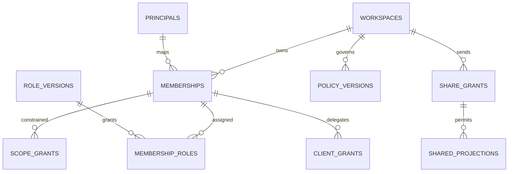
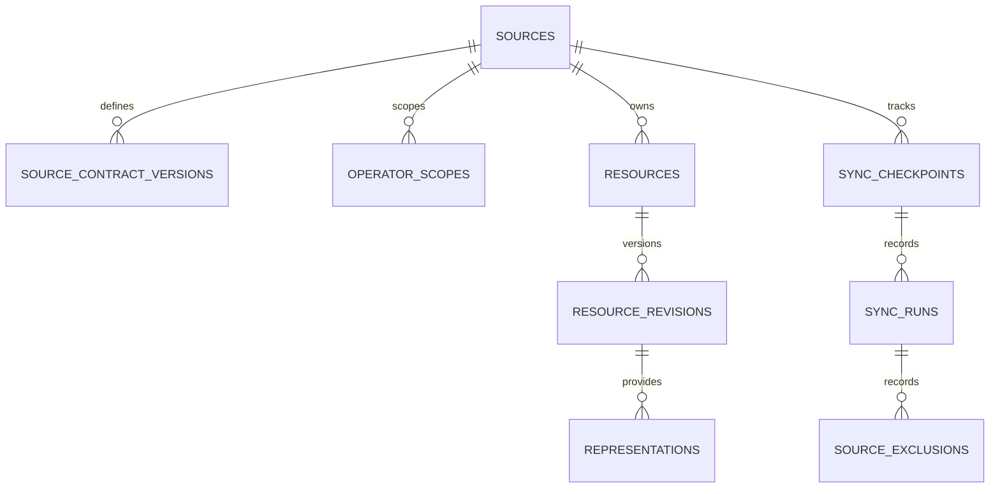
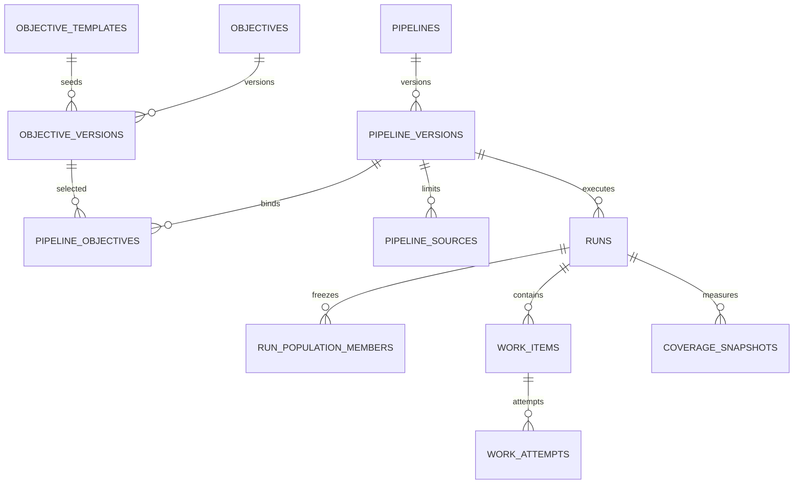
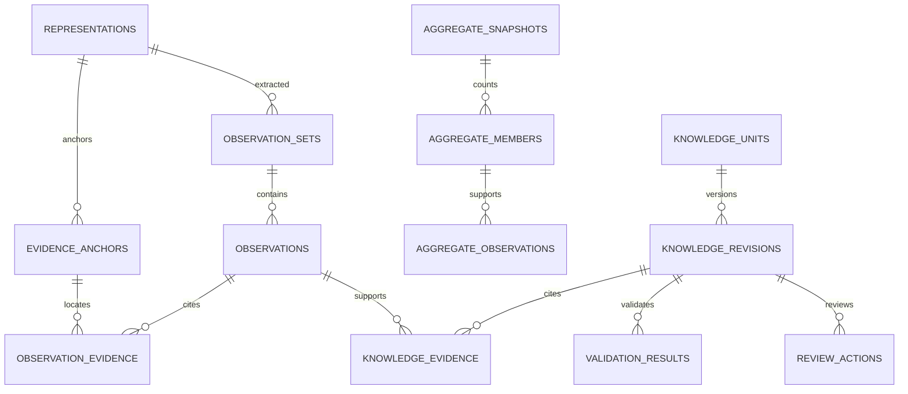
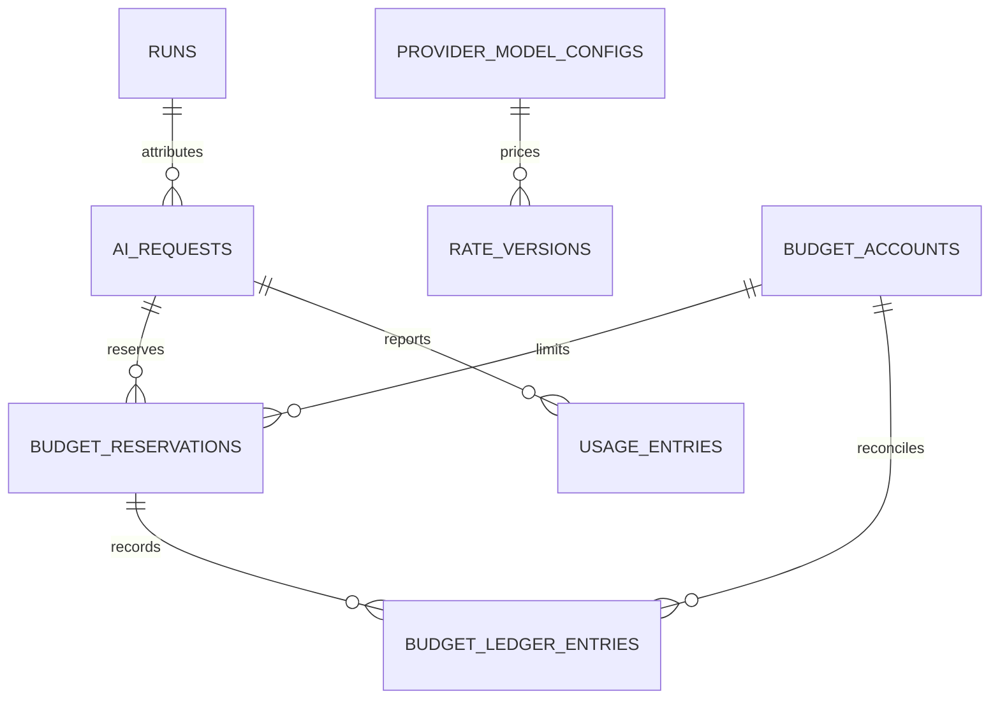

# Panadan — Data Model

Version: 0.1 | Date: 2026-11-26 | Status: Phase 6 approved by product owner; DM-01–DM-09 accepted as D-057–D-065
Baseline: 6c976e7670ee52688597276b81d536bbd0552dd4; [PRD](PRD.md), [Architecture](ARCHITECTURE.md), [Decisions](DECISIONS.md) D-001–D-056 (54 public entries). Phase 5 AP-01–AP-10 accepted as D-047–D-056. Phase 6 approval and UI direction recorded at 5ef59baf35911a826d81cc7626aad9f3a2265283 (D-057–D-066; 64 public accepted entries).

## 1. Scope and conventions

This is a proposed implementable relational model, not applied DDL. Review naming, constraints and transactions before implementation; record accepted material changes in DECISIONS.md. Preserve legacy reporting, source read-only, and existing identity authority. All new tables live in proposed schema panadan_knowledge on the **owned** PostgreSQL 18-compatible database. No changes to Odoo, existing panadan_ingest or panadan_auth migrations. First real pilot: one approved workspace/operator and 30-day window; synthetic fixtures first. Unknown source semantics, provider terms, retention and cost caps block real activation, not schema planning.

Conventions used in table catalog:
- T = workspace_id UUID NOT NULL; I = id UUID NOT NULL (server generated; UUIDv7 recommended if supported by verified runtime, otherwise UUIDv4). Each tenant table has PK (T,I), FK T to workspaces, explicit T on every tenant FK. Opaque IDs do not authorize access.
- A field marked ? is nullable; others NOT NULL unless generated/explicitly conditional. uuid references refer to same-workspace composite keys unless explicitly marked global. rev = positive integer, timestamptz in UTC for actual instants, date for calendar dates, text with bounded lengths, jsonb with named schema/version and bounded size; bigint for counts/cursors, numeric for precise quantities and amounts. No floats for money. Each row has created_at timestamptz; mutable control rows also updated_at and lock_version bigint. Versioned payloads immutable after publication except lifecycle availability and authorized retention deletion. Use RESTRICT by default; never cascade into source or broad tenant history.
- FK notation ref(table) means composite FK (T, field) → (T,id); use additional parent ownership keys for revision pointers. A nullable composite FK has T present and target ID nullable, only allowed for intentionally absent references. For global tables, explicit global FK and role rules. Unique keys always include T for tenant data.
- JSON is for bounded typed contextual extensions and immutable configuration snapshots, not a substitute for FKs, permissions, counts or budget constraints. Validate in application against versioned schemas and DB shape/size checks. Unknown values represented as null plus reason where meaningful; never fabricate fields. Strings and errors are restricted/sanitized; no secrets or raw transcript payloads in metadata.
- Proposed data classes: operational, filtered_sensitive, restricted_derived, shareable_projection. Classes do not themselves grant access. Source scope, membership, purpose and disclosure approval intersect. No raw unredacted call data in any new durable table, WAL, queue, cache, backup, audit, crash dump or error. Even filtered text is sensitive.
- Table inventory below is a design target; implement incrementally, not every table in first migration. Status names and constraints are proposed for review.

## 2. Workspace, identity and access

Existing SQLite is the default identity authority. Existing PostgreSQL auth selector is deliberately staging-only. Bridge to verified stable account identity with installation namespace; verify actual stable account contract (including account recreation and migration) before activation. No email/display-name binding, duplicate auth or legacy auto-grants. If stable identity or revocation cannot be verified, deny and review single-authority migration.

| Table | Fields (in addition to conventions) | Keys / constraints |
| --- | --- | --- |
| workspaces (global registry) | id uuid PK, slug text, name text, state text, policy_epoch bigint, timezone text?, created_at, updated_at | unique slug; state disabled/active/suspended; epoch nonnegative; no unrestricted registry listing |
| principals (global restricted) | id uuid PK, authority_namespace text, authority_subject text, kind text, state text | unique (authority_namespace,authority_subject); human/service; active/disabled; identity mapping only, no passwords or token copies |
| memberships | principal_id uuid global FK, state text, granted_by uuid? global FK, revoked_at timestamptz? | unique (T,principal_id); active/revoked; membership is not universal data access |
| role_versions | role_key text, rev int, name text, capability_set jsonb, state text | unique (T,role_key,rev); validated capability catalog; no malformed default grant |
| membership_roles | membership_id ref(memberships), role_version_id ref(role_versions), granted_by ref(memberships), valid_until timestamptz?, revoked_at timestamptz? | unique assignment identity; granting authority checked; current role version explicit |
| scope_grants | membership_id ref(memberships), capability text, scope_kind text, source_id? ref(sources), operator_scope_id? ref(operator_scopes), data_class text, purpose text, valid_from timestamptz, valid_until?, revoked_at?, grantor ref(memberships) | explicit scope_kind for workspace/source/operator; CHECK target matches kind, operator belongs to source; missing scope never wildcard by accident |
| client_grants | membership_id ref(memberships), authority_client_ref text, channel text, capabilities jsonb, permitted_data_classes jsonb, purpose text, valid_until?, revoked_at? | references verified legacy token/client identity, no raw token; unique active (T,membership,channel,client_ref); current legacy consent independently required |
| policy_versions | kind text, policy_key text, rev int, definition jsonb, state text, approved_by? ref(memberships), approved_at? | unique (T,kind,key,rev); kinds access/redaction/retention/validation/disclosure; immutable published definition; no unapproved activation |
| share_grants | recipient_workspace_id uuid global FK, package_version_id ref(package_versions), projection_version bigint, permission text, approved_by ref(memberships), valid_until?, revoked_at? | sender T != recipient; explicit recipient and purpose, active grant only; no direct cross-tenant evidence FK |
| shared_projections | share_grant_id ref(share_grants), projection_version bigint, permitted_payload jsonb, state text, expires_at? | unique (T,share_grant_id,projection_version); only sanitized approved projection; recipient access via narrow authorized service, not raw table RLS bypass |

Capability catalog proposed: resource.list/read/representation.read, evidence.read, objective.configure, pipeline.configure/run, knowledge.read/review, taxonomy.review, package.manage/share, app.read/configure, provider.manage, budget.manage/read, client.delegate, distribution.configure/run, audit.read. Separate egress permission by destination/client/provider and data class. Scope grants apply to current source/representation access; deny precedence and current membership. Role capabilities are upper bounds, not bypass for scope grants. Grantor must possess delegated authority. Revocation increments workspace policy_epoch and is audited; existing authentication/consent rechecked at dispatch and publication. Role/epoch caches never authorize alone. Explicit shared projection service checks both sender and recipient current policy, version, expiry and underlying evidence validity. No tenant switching by trusting user-supplied T.



## 3. Resources and source collection

| Table | Fields | Keys / constraints |
| --- | --- | --- |
| sources | source_key text, kind text, label text, connection_ref text?, state text, current_contract_id? ref(source_contract_versions) | unique (T,source_key); database/manual/web; disabled by default; secret reference only |
| source_contract_versions | source_id ref(sources), rev int, identity_spec jsonb, field_allowlist jsonb, timestamp_spec jsonb, revision_spec jsonb, delete_spec jsonb, adapter_version text, policy_version_id ref(policy_versions), approval_state text | unique (T,source_id,rev); current pointer must belong to source; unverified contracts cannot run live |
| operator_scopes | source_id ref(sources), contract_id ref(source_contract_versions), external_operator_key text, display_label text?, state text, verified_at? | unique (T,source_id,external_operator_key); contract must belong to source; opaque approved key, no name-based auth |
| resources | source_id ref(sources), external_id text, resource_type text, current_revision_id? ref(resource_revisions), availability text, first_seen_at, last_seen_at | unique (T,source_id,external_id); current revision must belong to resource; availability active/stale/restricted/deleted/unknown |
| resource_revisions | resource_id ref(resources), contract_id ref(source_contract_versions), rev int, source_marker text?, source_order jsonb?, observed_at, event_at?, event_date date?, event_time_quality text, operator_scope_id? ref(operator_scopes), operation text, normalized_metadata jsonb, schema_version text, filtered_digest text?, retention_policy_id ref(policy_versions), availability text | unique (T,resource_id,rev); verified source/contract/operator consistent; upsert/tombstone; source-order comparison adapter-specific, not lexical arbitrary string |
| representations | resource_revision_id ref(resource_revisions), kind text, representation_rev int, text_payload text?, structured_payload jsonb?, approved_ref text?, storage_mode text, data_class text, redaction_policy_id? ref(policy_versions), schema_version text, filtered_digest text?, availability text, expires_at? | unique (T,resource_revision_id,kind,representation_rev); payload mode exclusive; call text only filtered with approved redaction version; no raw-original storage mode for call pilot |
| sync_checkpoints | source_id ref(sources), contract_id ref(source_contract_versions), scope_key text, stream text, cursor jsonb, cursor_version bigint, last_success_at? | unique (T,source_id,contract_id,scope_key,stream); cursor validated; CAS; new policy/window must not reuse incompatible cursor |
| sync_runs | checkpoint_id ref(sync_checkpoints), state text, started_at, finished_at?, examined bigint, accepted bigint, unchanged bigint, excluded bigint, failed bigint, error_code text? | counters nonnegative; outcomes partition examined where defined; no payload logs |
| source_exclusions | sync_run_id ref(sync_runs), resource_id? ref(resources), safe_identity_ref text?, reason_code text, terminal boolean | bounded metadata, no rejected text; terminal only per policy; ambiguous failures must not be hidden by advancing checkpoint |
| attribute_schema_versions | schema_key text, rev int, applies_to text, json_schema jsonb, state text | unique (T,schema_key,rev); schemas code-reviewed/validated, no arbitrary executable config |

Resource = logical source item. Revision = exact observed source state under verified contract. Representation = approved filtered text, permitted metadata or reference, separately versioned. Do not equate representations with separate calls. Use composite parent constraints to ensure source contract and operator belong to same source; derive source through resource when not stored, or denormalize with enforced composite FK. Current pointer set only after complete durable revision. Version uniqueness is local; source marker may not be a unique revision without contract evidence. Dedup by verified event identity/order plus safe filtered digest/config, not timestamp alone. Equal marker with conflicting allowed content is quarantined; absent marker cannot prove latest. A new redaction version may create new representation without source mutation; downstream evidence binds exact representation.



### Odoo source field mapping (pending contract)

Migration 007 implements the initial synthetic call subset of the resource model. `operator_scopes` keeps stable source-local IDs, and `contract_operator_scopes` pins which operators belong to each contract version. `source_scope_grants` is separate from operational workspace grants and requires an explicit source or operator target. The synthetic v1 contract uses a positive numeric call ID, an explicit UTC event timestamp and a monotonic revision number. The schema currently accepts integer call duration and filtered transcripts with a payload digest. Future attributes, source kinds and live contracts require reviewed migrations and runtime checks.

| Source field | Proposed representation | Rule |
| --- | --- | --- |
| id | external_id | Verify stable uniqueness across joins/time; duplicate IDs cannot silently collapse calls |
| vw_danix_base_info_users | operator scope key | Candidate numeric ID only; verify assignment and cross-period stability |
| pipeline_expert_id | optional attributed context | Not assumed interchangeable with operator |
| vw_danix_base_info_users_name | optional display label | Never authorization key |
| CALLDATE, call_time, create_date | event_date/event_at or source-created time with provenance | Source meaning/timezone not confirmed; do not substitute creation time for call event; unknown dates excluded from initial window or explicitly flagged |
| voice_length | duration_seconds numeric | Seconds confirmed; retain unknown/out-of-range explicitly |
| transcription | filtered transcript representation | Primary semantic evidence, ASR fallible; no raw durable copy |
| summary, outcome, ai_recommendation, AI score/status | optional attributed supplementary data | Not independent evidence or verified payment; minimize; default omit until approved |
| deal_value, currency metadata | excluded initially unless verified | Zero/unverified values not revenue |
| update marker (sync_updated_at/updated_at/write_date) | source_marker + typed order | Verify source semantics, joined changes, deletes, timezone; no guessed ordering |
| customer identifiers and contact data | excluded by default | No individual identity resolution or raw identifier persistence |

Freeze half-open approved pilot bounds [start,end) after confirming source event clock/timezone, selected operator and eligible distinct source IDs. Scope filter at source, verify again before storage; parameterized bounded SELECT only. Existing Odoo adapter fixed global fields and existing raw ingest are not safe drop-in paths. New filtered ingestion transaction commits accepted revision, new work intent and cursor together. Record supported tombstones only; never infer deletion from a missing page. Source change/reassignment revokes local eligibility immediately when detected; no source writes.

## 4. Objectives, pipelines and execution

| Table | Fields | Keys / constraints |
| --- | --- | --- |
| objective_templates (global catalog) | id uuid PK, template_key text, rev int, definition jsonb, state text, created_at | unique key/rev; curated templates only; no tenant content |
| objectives | objective_key text, label text, current_version_id? ref(objective_versions), state text | unique (T,objective_key); current pointer same parent |
| objective_versions | objective_id ref(objectives), template_id? global FK, rev int, purpose text, output_schema_id ref(attribute_schema_versions), context_schema_id ref(attribute_schema_versions), validation_policy_id ref(policy_versions), config jsonb, state text | unique (T,objective_id,rev); immutable active config; allowed source kinds explicit |
| pipelines | pipeline_key text, label text, current_version_id? ref(pipeline_versions), state text | unique (T,pipeline_key); disabled by default |
| pipeline_versions | pipeline_id ref(pipelines), rev int, scope_spec jsonb, preprocessing_version text, model_config_id? ref(provider_model_configs), validation_policy_id ref(policy_versions), execution_limits jsonb, state text | unique (T,pipeline_id,rev); typed config, source/model authorization rechecked |
| pipeline_objectives | pipeline_version_id ref(pipeline_versions), objective_version_id ref(objective_versions), stage_order int | unique pair; compatible grouping explicit |
| pipeline_sources | pipeline_version_id ref(pipeline_versions), source_id ref(sources), contract_id ref(source_contract_versions), operator_scope_id? ref(operator_scopes), scope_kind text | same source parent; scope-kind checks; no implicit wildcard |
| schedules | pipeline_version_id ref(pipeline_versions), schedule_spec jsonb, timezone text, enabled boolean, next_due_at? | validated bounded schedule; disabled default |
| runs | pipeline_version_id ref(pipeline_versions), schedule_id? ref(schedules), occurrence_key text?, request_key text?, trigger text, requested_by? ref(memberships), manifest jsonb, policy_epoch bigint, scope_start?, scope_end?, state text, started_at?, finished_at?, stop_reason? | unique scheduled occurrence (T,schedule_id,occurrence_key); unique manual request key (T,request_key) when present; immutable scope/config |
| run_population_members | run_id ref(runs), resource_revision_id ref(resource_revisions), resource_id ref(resources), eligibility text, reason_code? | unique (T,run_id,resource_id); revision belongs to resource; frozen measured population, not a claim of complete source |
| work_items | run_id ref(runs), stage text, resource_revision_id? ref(resource_revisions), input_ref jsonb, effect_key text, state text, priority int, available_at, lease_until?, fence bigint, attempt_count int, max_attempts int, error_code? | unique (T,run_id,effect_key); typed refs resolved and checked; no payload; fence monotonic; active lease only running |
| work_attempts | work_item_id ref(work_items), attempt_no int, fence bigint, started_at, finished_at?, outcome text, error_code? | unique (T,work_item_id,attempt_no), unique fence per item; attempts bounded |
| coverage_snapshots | run_id ref(runs), stage text, metric_version text, as_of timestamptz, eligible_count bigint?, attempted bigint, succeeded bigint, failed bigint, excluded bigint, pending bigint?, completeness text | unknown total nullable; partition consistency for comparable denominator; separate collection/extraction/validation coverage |

Use a durable manifest pinning exact IDs/versions, approved scope, schema, taxonomy, preprocessing, provider, policy epoch and budget references; do not put raw source text in manifest. Resolve JSON refs to relational FK-backed records before execution; critical authorization refs are relational (pipeline_sources, population members, task resource). New scopes/versions create new run. Validate job stage payload shape and effect key canonicalization. Proposed run states queued/running/paused/blocked_policy/blocked_budget/succeeded/partial/failed/canceled. Item states queued/running/retry_wait/blocked_policy/blocked_budget/paused/succeeded/failed/quarantined/canceled. State transitions only through command service with expected version/fence; no direct status edits. Terminal result plus next intent in same short transaction. Reopening failed job requires authorized retry/new attempt, not resetting ledger. Lease expiry requeues only after classifying uncertain external effects. Claim via SKIP LOCKED short transaction, release DB locks before network. Fence prevents stale completion. Scheduled occurrence dedup, bounded retries, fair separate fresh/backfill queues.



## 5. Observations, evidence, taxonomy and knowledge

| Table | Fields | Keys / constraints |
| --- | --- | --- |
| observation_sets | representation_id ref(representations), run_id ref(runs), extraction_signature text, schema_id ref(attribute_schema_versions), compatibility_spec jsonb, state text, completed_at? | unique (T,representation_id,extraction_signature); only complete current authorized compatible result reusable |
| observation_set_objectives | observation_set_id ref(observation_sets), objective_version_id ref(objective_versions) | unique pair; explicit coverage not presumed for all objectives |
| observations | observation_set_id ref(observation_sets), kind text, ordinal int, subject text, speaker text, typed_value jsonb, context jsonb, uncertainty text?, availability text | unique (T,set,ordinal); schema validated, no unsupported speaker attribution |
| evidence_anchors | representation_id ref(representations), anchor_kind text, start_cp int?, end_cp int?, structured_locator jsonb?, state text | text anchors half-open codepoint range 0<=start<end; structured locator validated; no raw excerpt duplication |
| observation_evidence | observation_id ref(observations), anchor_id ref(evidence_anchors), relation text | unique pair/relation; anchor must match observation set's representation or approved explicit dependency |
| taxonomy_versions | taxonomy_key text, rev int, state text, approved_by? ref(memberships) | unique (T,key,rev); approved immutable snapshot |
| categories | taxonomy_key text, category_key text, state text | unique (T,taxonomy_key,category_key); stable identity |
| category_versions | taxonomy_version_id ref(taxonomy_versions), category_id ref(categories), parent_category_id? ref(categories), label text, definition text?, state text | unique (T,taxonomy_version_id,category_id); parent exists in same version; no cycles; unknown/unmatched explicit |
| category_suggestions | taxonomy_version_id ref(taxonomy_versions), proposed_label text, proposed_parent_id? ref(categories), rationale text, state text, reviewed_by? ref(memberships), review_reason? | proposed/approved/rejected; approval creates new taxonomy version, never auto-mutates |
| suggestion_evidence | suggestion_id ref(category_suggestions), observation_id ref(observations) | unique pair; current authorized evidence |
| observation_categories | observation_id ref(observations), category_version_id ref(category_versions), assignment_method text | unique pair; version-aware; overlapping categories allowed |
| aggregate_snapshots | run_id ref(runs), objective_version_id ref(objective_versions), taxonomy_version_id? ref(taxonomy_versions), metric_key text, scope_spec jsonb, condition_spec jsonb, eligible_count bigint?, processed_count bigint, matched_count bigint, completeness text, as_of | matched <= processed; eligible >= processed when known/comparable; metric definition/version in scope |
| aggregate_members | aggregate_id ref(aggregate_snapshots), resource_id ref(resources), resource_revision_id ref(resource_revisions), matched boolean | unique (T,aggregate_id,resource_id); exact processed distinct-call denominator membership and matched flag; revision matches parent |
| aggregate_observations | aggregate_member_id ref(aggregate_members), observation_id ref(observations) | unique pair; observation belongs to member revision; evidence support not independent count |
| knowledge_units | knowledge_key text, kind text, current_revision_id? ref(knowledge_revisions), state text | unique (T,knowledge_key); current revision same parent; no text-only dedup |
| knowledge_revisions | knowledge_unit_id ref(knowledge_units), rev int, claim text, subject text, claim_type text, conditions jsonb, valid_from?, valid_until?, observed_period_start?, observed_period_end?, aggregate_id? ref(aggregate_snapshots), schema_id ref(attribute_schema_versions), validation_policy_id ref(policy_versions), data_class text, freshness_until?, lifecycle_state text, availability text | unique (T,unit,rev); time ranges valid; immutable claim payload; authoritative only with current sufficient validation |
| knowledge_evidence | knowledge_revision_id ref(knowledge_revisions), observation_id ref(observations), anchor_id ref(evidence_anchors), relation text, source_authority text, independence_group text | unique revision/observation/anchor/relation; relation support/contradict/context; anchor linked to observation; group based on source provenance, not model confidence |
| validation_results | knowledge_revision_id ref(knowledge_revisions), policy_id ref(policy_versions), evaluation_no int, reliability_result jsonb, prevalence_result jsonb, importance_result jsonb, risk_class text, outcome text, evaluated_at, valid_until? | unique (T,revision,evaluation_no); policy version exact; outcome pass/fail/needs_review; no universal composite score |
| review_actions | knowledge_revision_id ref(knowledge_revisions), validation_result_id? ref(validation_results), reviewer_id ref(memberships), action text, rationale text, expected_lock_version bigint | append-only under policy; no human override of hard privacy/evidence checks |
| knowledge_transitions | knowledge_revision_id ref(knowledge_revisions), from_state text?, to_state text, reason_code text, actor_id? ref(memberships), validation_result_id? ref(validation_results) | immutable audit of transition; system actor explicitly identified |
| invalidation_events | resource_revision_id? ref(resource_revisions), representation_id? ref(representations), knowledge_revision_id? ref(knowledge_revisions), reason_code text, state text, policy_epoch bigint | exactly one triggering reference; idempotent key; suppress dependent authority before recompute |

Anchor offsets are Unicode code points in exact stored filtered text, not byte/UTF-16 offsets or original text. Validate span length/substring against representation; render UI offsets by explicit conversion. Do not persist raw-to-filtered mapping containing identifiers. Structured anchor paths restricted to approved typed attributes. Model-generated locators never trusted blindly. Evidence revocation/expiry is checked on read even while invalidation work is pending.

Extraction signature = canonical versioned digest of tenant + representation identity/version + semantic schema/task versions + preprocessing/redaction + provider/model/config + compatible purpose/policy context. Include task prompt version, not confidential prompt text. No cross-tenant reuse. If schema/meaning, policy or source state changes, invalidate/re-extract affected coverage; do not silently reuse. A set may cover multiple objectives only with explicit compatibility rows. Prior upstream AI analyses are supplementary attributed observations, not independent corroboration. Speaker statements are not verified external facts.



### Knowledge lifecycle and aggregates

Proposed transitions: proposed → under_review/active/rejected; under_review → active/rejected/proposed; active → disputed/outdated/archived; disputed/outdated → under_review or archived (reassess; new claim content requires new revision); rejected → archived. Revocation/retention is a separate availability state; no transition can override unavailable evidence. Publication transaction checks current evidence, scope, validation version, review requirements and freshness, sets pointer/state and writes transition/outbox. A partial unique index for active revision per unit is a candidate if one active revision is required; use explicit unit locking, do not force incompatible contexts into one unit. Corrections create new revisions; different conditions can be distinct units. No universal minimum evidence count. A claim with expired/missing evidence is immediately ineligible for authoritative reads; prior version not automatically current. Keep history as policy permits. Retention can erase payload but preserve minimal permitted tombstone; never restore authority from stale history. Physical design must make erasable claim/observation payloads nullable only in explicitly purged states or separate them into restricted payload tables; never retain mandatory plaintext merely to satisfy a history constraint.

Prevalence = matched distinct processed calls / comparable processed distinct calls; coverage = processed eligible calls / known eligible calls; denominator zero/unknown yields null, never zero by default. Display count, population/period, metric definition, exclusions, scope and coverage together. Exact counts derived from membership, not model numbers: processed_count equals distinct aggregate_members and matched_count equals members with matched=true; eligible_count derives from the corresponding frozen population where measurable. Reconcile persisted snapshot counts against relational membership at publication. Multiple topics overlap. Rare findings may be narrow validated claims or candidates, not broad demand. No unique customer counts or market/organization-wide inference.

## 6. Typed data contracts and seven objectives

Common observation contract: version, kind, subject, speaker (customer/agent/unknown/other), value object, context object, evidence locator(s), uncertainty and source attribution. Trusted resource/tenant/version supplied by task; model cannot select them. All fields bounded; additionalProperties false on fixed envelopes; extensible context allowed only through approved schema. Distinguish null reason unknown/not_applicable/not_observed/redacted. Suggested initial typed fields (not final extraction prompt):

| Objective | kind / value fields | Context and safety |
| --- | --- | --- |
| KO-01 Customer Questions | question: wording, topic_key?, question_type? | actual question, not verified answer |
| KO-02 Customer Needs & Preferences | preference: need, preference_strength?, explicitness | distinguish expressed vs inferred |
| KO-03 Customer Concerns | concern: subject, concern_type?, stated_reason? | fear not proof of event |
| KO-04 Purchase Barriers | barrier: obstacle, stage?, reported_outcome? | no inferred causality/confirmed sale |
| KO-05 Destination Intelligence | destination_mention: destination?, intent?, topic? | mention not booking or market demand |
| KO-06 Price Sensitivity | price_signal: signal_type, amount?, currency?, price_basis?, reaction? | distinguish budget/quote/payment; no guessed currency |
| KO-07 Content Opportunities | content_opportunity: topic, audience?, objective, rationale, format?, outline | derived from validated knowledge refs, not source-only observations or SEO volume |

Synthetic example (illustrative, no real data):
```json
{
  "schema_version": "observation.price_signal.v1",
  "kind": "price_signal",
  "subject": "additional travel costs",
  "speaker": "customer",
  "value": {"signal_type": "concern", "amount": null, "currency": null, "price_basis": null, "reaction": "asked_about_extra_cost"},
  "context": {"destination": null, "travel_start": null, "travel_end": null, "hotel": null, "room_type": null, "traveler_count": null, "inclusions": null, "quote_valid_until": null},
  "evidence": [{"kind": "filtered_text_span", "start_cp": 0, "end_cp": 16}],
  "uncertainty": "amount_not_observed"
}
```
The span is illustrative; accepted output must match actual filtered text and semantics. Numeric money amounts use decimal strings in API/model JSON, validated exact NUMERIC internally. Currency ISO code when verified; unit and price basis explicit. Date/calendar vs timestamp distinct. Travel context can include destination, dates, hotel/room, traveler counts/ages only when permitted, flights/meals/transfers/inclusions, quote validity and inventory. Unknown is not contradiction. Current offer belongs to Resource. No unrestricted attribute editor. Typed extension schemas versioned per workspace/resource/claim type, with code-reviewed primitives for MVP.

## 7. Packages, applications and consumption

| Table | Fields | Keys / constraints |
| --- | --- | --- |
| packages | package_key text, label text, current_version_id? ref(package_versions), state text | unique (T,key); private by default |
| package_versions | package_id ref(packages), rev int, purpose text, version_policy text, state text, approved_by? ref(memberships) | unique (T,package_id,rev); immutable published membership |
| package_members | package_version_id ref(package_versions), knowledge_revision_id ref(knowledge_revisions), ordinal int | unique pair and ordinal; pinned exact revision for MVP; new version to update, no silent follow-latest |
| application_configs | app_key text, rev int, app_kind text, config jsonb, state text, current boolean | unique (T,key,rev); one current active version; customer_intelligence/content_intelligence |
| application_objectives | app_config_id ref(application_configs), objective_version_id ref(objective_versions) | unique pair; approved shared core |
| application_packages | app_config_id ref(application_configs), package_version_id ref(package_versions) | unique pair; no added access |
| content_opportunities | app_config_id ref(application_configs), logical_key text, rev int, title text, audience text?, rationale text, suggested_format text?, scope jsonb, state text, freshness_until? | unique (T,logical_key,rev); current version explicit; no SEO inference |
| opportunity_knowledge | opportunity_id ref(content_opportunities), knowledge_revision_id ref(knowledge_revisions) | unique pair; required validated current permitted dependencies |
| content_briefs | opportunity_id ref(content_opportunities), rev int, title text, objective text, outline jsonb, constraints jsonb, state text, freshness_until?, generation_request_id? ref(ai_requests) | unique (T,opportunity_id,rev); no CMS/draft body required |
| brief_knowledge | brief_id ref(content_briefs), knowledge_revision_id ref(knowledge_revisions) | unique pair; check current authority and policy on read |

Customer Intelligence uses authorized SQL/query DTOs over knowledge and aggregate snapshots; no independent facts or duplicated insight table required initially. Optional measured read models later, not mandatory. Briefs and opportunities are derived strategy artifacts, not authoritative knowledge. No in-panel article editor, publication state or individual customer profiles. Resource and Knowledge query services independent; all filters scoped, stable cursor, capped size. Package versions and evidence permissions intersect; return allowed projection without disclosing forbidden membership/counts. Shared projections are revocable and versioned, no direct recipient access to sender raw rows. External client drafting independent disclosure and cost. UI/API/MCP share same definitions and freshness; legacy reporting contracts retained.

## 8. AI providers, cost ledger and budgets

| Table | Fields | Keys / constraints |
| --- | --- | --- |
| provider_model_configs | provider_key text, model_key text, rev int, managed_secret_ref text, endpoint_config_ref text, limits jsonb, state text | unique (T,provider,model,rev); no secret value or arbitrary endpoint; admin-only, central managed config |
| provider_disclosure_grants | model_config_id ref(provider_model_configs), purpose text, data_class text, policy_id ref(policy_versions), valid_until?, revoked_at? | explicit allowed combination; no default fallback; verified downstream terms privately |
| rate_versions | model_config_id ref(provider_model_configs), rev int, currency text, unit_prices jsonb, effective_from, effective_until?, state text | unique (T,model_config_id,rev); verified rates, exact decimal; unknown fees block bounded admission |
| budget_accounts | scope_kind text, run_id? ref(runs), currency text, period_start?, period_end?, cap numeric(30,12), reserved numeric(30,12), committed numeric(30,12), state text, version bigint | nonnegative; org scope run null; run scope run nonnull; unique org period/currency and run/currency; no overlapping active org periods; overrun may be recorded, must block admission not reject actuals |
| ai_requests | run_id ref(runs), work_attempt_id? ref(work_attempts), model_config_id ref(provider_model_configs), rate_version_id ref(rate_versions), purpose text, request_key text, provider_request_ref text?, status text, policy_epoch bigint, started_at?, finished_at?, input_tokens bigint?, output_tokens bigint?, error_code? | unique (T,request_key) per chargeable attempt; provider idempotency only if contract supports; no payload or raw response |
| budget_reservations | ai_request_id ref(ai_requests), budget_account_id ref(budget_accounts), amount numeric(30,12), state text, resolved_at? | unique request/account; two applicable reservations in same atomic admission; uncertain not released |
| usage_entries | ai_request_id ref(ai_requests), entry_key text, currency text, amount numeric(30,12)?, amount_kind text, input_tokens?, output_tokens?, recorded_at | unique (T,request_id,entry_key); estimated/reported/unknown/adjustment; signed corrections authorized; unknown amount null not zero |
| budget_ledger_entries | budget_account_id ref(budget_accounts), reservation_id? ref(budget_reservations), usage_entry_id? ref(usage_entries), event_key text, reserved_delta numeric(30,12), committed_delta numeric(30,12), reason_code text | unique (T,account,event_key); immutable deltas; transactional balance reconciliation |
| budget_change_events | budget_account_id ref(budget_accounts), actor_id ref(memberships), old_cap numeric, new_cap numeric, reason text, expected_version bigint | audited authorized change; no silent reset |

Use one approved accounting currency per admission; currency/period/precision/rates and cap remain open before paid execution. No inferred FX or provider multiplier. Run budget and organization budget charge same underlying usage event; reporting must not sum both accounts as total expense. An application AI execution must use an explicitly configured governed pipeline version (including the Content Opportunities objective for brief generation) and a run with execution budget; no untracked non-pipeline dispatch. This is a proposed uniform execution contract, not an additional product capability. Under row locks in deterministic account order (or verified equivalent), check current policy, verified maximum cost, committed + reserved + new estimate <= cap for both accounts. Insert request and both reservations/ledger events atomically, audit intent; if denied no provider call. Do not keep DB transaction across network. Recheck egress authorization; release only verified unused reservation if never dispatched. On timeout with uncertain acceptance, keep reservation and reconcile. On actual usage, decrement reservation and apply actual committed spend idempotently; actual > estimate is recorded and blocks further admissions as required. Concurrent cap changes version-checked and audited. Retries new chargeable attempts unless provider contract proves idempotency. Track estimated and reported separately, do not treat missing as free. External MCP client charges not automatically captured. No wallet/billing/advanced quotas.



## 9. Distribution, audit and retention

| Table | Fields | Keys / constraints |
| --- | --- | --- |
| destinations | destination_key text, contract_rev int, connection_ref text, projection_schema_id ref(attribute_schema_versions), policy_id ref(policy_versions), state text | unique (T,key,contract_rev); separate credentials; disabled default |
| destination_packages | destination_id ref(destinations), package_version_id ref(package_versions), state text | unique pair; explicit approved projection scope |
| destination_projections | destination_id ref(destinations), knowledge_revision_id ref(knowledge_revisions), projection_key text, projection_version bigint, state text, payload jsonb?, expires_at? | unique (T,destination,projection_key,version); approved minimized payload only; version monotonic per projection key |
| outbox_deliveries | projection_id ref(destination_projections), operation text, delivery_key text, state text, fence bigint, lease_until?, available_at, attempt_count int, error_code? | unique (T,delivery_key); publish/withdraw/stale contract; no raw payload in job |
| delivery_attempts | outbox_id ref(outbox_deliveries), attempt_no int, fence bigint, outcome text, remote_ack_ref?, finished_at? | unique (T,outbox,attempt_no); uncertain outcomes reconcile, not blind retry |
| audit_events | principal_id? global FK, membership_id? ref(memberships), channel text, action text, target_kind text, target_ref text?, policy_epoch bigint, outcome text, correlation_id uuid, safe_metadata jsonb | metadata-only; durable sensitive intent before disclosure, no raw payload/secret |
| retention_tasks | target_kind text, target_ref text, policy_id ref(policy_versions), due_at, state text, fence bigint, outcome_code? | target kind allowlist and resolved scoped ID; no arbitrary SQL or source operations |
| erasure_records | target_kind text, target_ref text, policy_id ref(policy_versions), completed_at, reason_code text, restore_barrier bigint | minimal permitted tombstone; restricted; no payload or recoverable raw hash |
| evaluation_manifests | run_id ref(runs), stage text, sampling_spec jsonb, rubric_version text, thresholds jsonb, state text | private operational record, no actual corpus in repo; approval before next stage |
| evaluation_results | manifest_id ref(evaluation_manifests), objective_version_id? ref(objective_versions), metric_key text, numerator numeric?, denominator numeric?, value numeric?, method_version text, outcome text, limitations jsonb | actual measured results only; unknown null; stage gates separate from release |

Destination state and outbox intent commit with approved knowledge publication/withdrawal. Projection ordering and idempotency enforced at destination contract or safe reconcile; block if impossible. Recheck scope/authority/currentness before send. No source credentials or writes, no mutation of unrelated customer records. Withdraw only designated Panadan-managed projection under explicit contract; never promise external recall. Ledger and audit retention governed; no indefinite copies merely because immutable. Invalidation immediately suppresses affected read/dispatch; async recompute. Erasure removes local text/derived payload/cache/exports as required; approved minimal tombstones may remain; legal hold/retention conflicts require private policy review. Restore must reapply revocation and erasure barriers before access. Backup expiry and provider/destination terms explicit.

## 10. Physical integrity, RLS and runtime roles

Illustrative non-executable-in-this-phase SQL pattern (review before migrations):
```sql
CREATE TABLE panadan_knowledge.resources (
  workspace_id uuid NOT NULL REFERENCES panadan_knowledge.workspaces(id),
  id uuid NOT NULL,
  source_id uuid NOT NULL,
  external_id text NOT NULL,
  PRIMARY KEY (workspace_id,id),
  UNIQUE (workspace_id,source_id,external_id),
  FOREIGN KEY (workspace_id,source_id)
    REFERENCES panadan_knowledge.sources(workspace_id,id) ON DELETE RESTRICT
);
ALTER TABLE panadan_knowledge.resources ENABLE ROW LEVEL SECURITY;
ALTER TABLE panadan_knowledge.resources FORCE ROW LEVEL SECURITY;
CREATE POLICY resources_scope ON panadan_knowledge.resources
  USING (workspace_id = NULLIF(current_setting('panadan.workspace_id',true),'')::uuid)
  WITH CHECK (workspace_id = NULLIF(current_setting('panadan.workspace_id',true),'')::uuid);
```
Set context only inside trusted authorized transaction using parameterized set_config(...,true); missing/invalid context denies or errors safely; never accept arbitrary client SQL or assume RLS protects compromised runtime capable of choosing context. Recheck authority and explicit row/field predicates in application. Pool transaction reset tested (including exception paths). Table owner separate NOLOGIN; runtime roles NO BYPASSRLS, no owner/migration inheritance, no CREATE/DDL/TRUNCATE. Restrict functions/default privileges; SECURITY DEFINER only narrow audited functions with pinned search_path and explicit privilege revoke, no arbitrary tenant payload. Global registry/identity/catalog access through narrow services, not public grants. Cross-tenant sharing needs special checked projection, not general RLS exception. Worker scheduler may claim metadata through narrow reviewed dispatch operation; scoped worker transactions per workspace; no global payload scanning.

| Runtime role (proposed) | Scope |
| --- | --- |
| knowledge_web | authorized domain read and narrowly permitted configuration/review commands; no source/provider secrets |
| knowledge_collector | scoped source registry/filtered revision/checkpoint/intent writes; read-only source credential separate |
| knowledge_scheduler | metadata-only schedule and job intent/claim dispatch |
| knowledge_worker | scoped filtered reads, observations, validation, derived effects; no source connection |
| knowledge_gateway | scoped provider policy, request/budget ledger; managed secrets outside tables |
| knowledge_distribution | approved projection/outbox/attempt writes only; separate destination credential |
| knowledge_retention | narrow reviewed local purge/reconciliation procedures only |
| knowledge_migrator / backup | privileged separately controlled offline duties, no runtime inheritance |

Exact GRANT per operation and RLS per table must be implemented/tested before activation. Global auth remains existing authority; current legacy scope separately enforced. Use composite parent constraints for current revision pointers (T,parent_id,current_revision_id) → (T,parent_id,id), deferrable only where required for atomic insert/update. Many-parent consistency checks via composite keys or reviewed constraint triggers/transactions; do not rely on bare ID references. FK checks do not establish source eligibility or permission. Version rows immutable via role grants/command procedures and tests. State checks, positive revision, valid intervals and nonnegative counts enforced in DB; cross-row invariants (evidence sufficiency, budget reconciliation, taxonomy cycle, current pointer) enforced transactionally with locks/constraint checks.

## 11. Index and query plan

Proposed indexes, always tenant-leading for tenant queries unless narrow reviewed dispatcher:
| Access pattern | Index |
| --- | --- |
| Membership/current grants | (workspace_id,principal_id,state); scope_grants(T,membership_id,capability,source_id) with active predicate |
| Source identity and history | unique(T,source_id,external_id); resource_revisions(T,resource_id,rev DESC); (T,operator_scope_id,event_at,id) where available |
| Resource list | (T,source_id,last_seen_at DESC,id); filter by verified scope before pagination |
| Representation/evidence | (T,resource_revision_id,kind); anchors(T,representation_id); reverse FKs for all dependency links |
| Run/queue | runs(T,state,created_at,id); work_items(T,state,available_at,priority,id) partial eligible; lease expiry(T,lease_until) for running; narrow metadata-only global dispatch index if reviewed |
| Observation reuse | unique(T,representation_id,extraction_signature); observations(T,observation_set_id,kind) |
| Aggregate and taxonomy | aggregate_members(T,aggregate_id,resource_id); category assignments(T,category_version_id,observation_id) |
| Knowledge feed | (T,lifecycle_state,freshness_until,id); revision parent; evidence reverse observation/anchor indexes; review queue partial index |
| Packages/apps | member lookup by package/revision; reverse dependency indexes for invalidation; content opportunity current/state/freshness |
| Budget/outbox | requests(T,run_id,created_at), account period, reservation/request unique, ledger(T,account,created_at,id); outbox(T,state,available_at,id), lease expiry |
| Audit/retention | audit(T,created_at,id), target ref; retention(T,state,due_at,id) |

Every referencing FK needs measured index support for joins/deletion checks. Start with B-tree exact filters and bounded text search; evaluate Persian search normalization, GIN or full-text relevance only with actual requirements; no vector dependency. Avoid indexing sensitive free text unnecessarily. Use EXPLAIN on synthetic workload and authorized load tests; no claimed capacity/SLO. Keyset pagination on stable sort + ID; opaque cursor signed/validated against scope/filter; never expose unrestricted total counts. No partitioning until observed volumes/retention justify.

## 12. Transaction contracts and state transitions

| Operation | Atomic local effects and boundary |
| --- | --- |
| Collection page | lock scoped checkpoint/version; verify policy and source ordering; write only filtered revisions, exclusion outcome, work intent; CAS cursor; no source mutation |
| Claim task | scoped lease/fence and attempt insert; short transaction; execute outside; stale fence cannot finalize |
| Finalize observation | validate schema/anchors/current policy/fence; insert set/observations/evidence idempotently; next intent and outcome same transaction |
| Aggregate publication | freeze membership and metric definition; reconcile deterministic counts; version snapshot; no model count authority |
| Knowledge validation | lock unit/revision; evaluate current evidence/policy and authorized review; transition/current pointer/audit and eligible outbox intent together |
| Budget admission | lock org+run accounts deterministic order; verify estimate and cap; reserve both and request/audit intent; no dispatch if denied |
| Charge reconciliation | idempotent usage and ledger deltas; release only known reservation; uncertain holds; record overrun |
| Taxonomy update | validate cycle/parent/version, review action; new immutable version and mappings; no silent historical reclassification |
| Revocation/expiry | increment epoch, suppress affected scope/authority, durable invalidation intent; cancel future work; recheck in-flight; cannot recall already transmitted data |
| Destination claim/finalize | fence lease, recheck policy/version, send outside tx; acknowledge/reconcile; old version never overwrites new |
| Local purge | verify policy and target scope, suppress access, delete permitted local payloads/derivatives, invalidate pointers; durable minimal erasure barrier; no external source delete |

Idempotency keys generated from trusted scoped canonical identities; no tenant-global key or user-controlled effect identity. External calls at least once/uncertain, never exactly once guarantee. State transitions audit actor, expected version, reason and outcome. Reconcile after crash, backup restore and external ack gap.

## 13. Migration strategy and acceptance

Existing migration 001 creates panadan_ingest.sources/source_records/raw_revisions/processing_jobs/derived_facts/sync_checkpoints/sync_runs with source-key namespaces and no tenant isolation. Migration 003 creates panadan_auth foundation; current production identity selector still SQLite. Existing permissions scripts narrow roles but not the new workspace model. No edit of applied migration files, no destructive migration or automatic copy. Proposed additive sequence (numbering reserved for implementation review):
1. Owned DB guard, new schema/roles, workspace/principal/policy foundations; synthetic two tenants and RLS tests. No production auth switch.
2. Sources/contracts/resources/filtered representations/checkpoints; new reader, no copying unredacted legacy raw payload. Verify private mapping before any import. Existing legacy records remain isolated.
3. Objectives/pipelines/runs/jobs, schema catalogs and AI ledger with mock provider; lease/replay and concurrency tests.
4. Observations/evidence/aggregation, knowledge/review/taxonomy/invalidation; package/app query projections.
5. Client grants/shared projections/destination outbox, audit/retention/evaluation completion. Use synthetic target.
6. Review private source contract, data rights/provider/retention/cap and E0 acceptance before authorized real sample. Verify backup/restore and legacy compatibility before separately approved deployment.

Schema migrations tested on disposable owned PostgreSQL with existing schema fixture and clean install. Use additive rollback (disable feature/workers; preserve compatible old state); no blind DROP/down migration, no production execution in this phase. Backups, ownership, source grant audit and restore evidence prerequisites. Never auto-assign legacy global records to first workspace. If authorized mapping impossible, leave isolated. No source schema migration.

| Test ID | Required invariant |
| --- | --- |
| DM-T01 | Same IDs in two tenants cannot read/write/link each other's records; missing context, malformed grant, revoked identity, pool reuse fail closed |
| DM-T02 | Current revision parent and source/operator/contract consistency; negative composite FK cases |
| DM-T03 | Raw leak canary absent from durable new tables/jobs/logs/backup; original unchanged; missing/ambiguous source scope blocked |
| DM-T04 | Source page replay, late updates, ambiguous marker, checkpoint CAS, tombstone and scope change |
| DM-T05 | Schedule dedup, concurrent claim, lease expiry/fencing, stale completion, crash/replay and bounded retry |
| DM-T06 | Exact span validation, compatible set reuse, schema mismatch, unsupported references and invalidation |
| DM-T07 | Distinct-call metrics and coverage with overlaps, null denominator, duplicate calls and changed revisions |
| DM-T08 | Validation state/review rules, expired/conflicting evidence, version correction and no stale authoritative retrieval |
| DM-T09 | Taxonomy cycle/version, package/recipient restrictions, revoked evidence, cross-tenant projection only |
| DM-T10 | Concurrent org/run budget, missing rate, uncertain timeout, actual overrun, retries and reconciliation idempotency |
| DM-T11 | Outbox retry/version race, revoked projection, separate credentials, unchanged unrelated destination/source rows |
| DM-T12 | Retention and restore barrier, audit fail-closed, legacy reporting/API/MCP/auth regression, two-workspace end-to-end |

No tests or SQL executed by this document. Exact DDL, trigger syntax, migration dependency cycles and plans require implementation verification. Circular parent/current pointers require nullable initial pointer and reviewed FK creation order.

## 14. Review choices and unresolved activation gates

Accepted data-model choices DM-01–DM-09, mapped in order to D-057–D-065. Physical DDL and test evidence remain pending:
| ID | Choice |
| --- | --- |
| DM-01 | Additive panadan_knowledge schema; preserve legacy schemas and identity bridge |
| DM-02 | Tenant composite PK/FKs, scoped runtime roles and RLS; explicit sharing projection |
| DM-03 | Logical resource + immutable revisions + separately versioned filtered representations |
| DM-04 | Versioned objective/pipeline/run manifests, frozen population and fenced work items |
| DM-05 | Compatible observation sets, exact representation evidence anchors and relational aggregation membership |
| DM-06 | Knowledge unit/revision separation, explicit lifecycle and evidence invalidation |
| DM-07 | Versioned taxonomy and pinned package membership, separate content strategy artifacts |
| DM-08 | Atomic dual-budget reservation, immutable usage/adjustment ledger and uncertain reconciliation |
| DM-09 | Versioned destination projection/outbox and local retention/restore barriers |

Open: O-01/02 source ID, time, operator assignment, actual field rights, update/delete contract; O-03 retention, redaction residual risk, access and backup; O-04 provider/model/intermediary and gateway reuse; O-05 currency/rates/cap; O-06/07 exact objective schemas/category seeds, risk/approval and evidence policy; O-08 sample/rubric/thresholds; O-09 file limits and web sources; O-10 actual MCP/OAuth and identity bridge; O-11 destination contract; O-12 operations and restore. Data-model review does not close these. Finalize detailed API DTO/DDL and security policies before respective increments.

Traceability: FR-01/19 → sections 2/10; FR-02–05 → 3/9; FR-06–09 → 4–6; FR-10–13 → 5–7; FR-14/15 → 8; FR-16–18 → 7; FR-20 → 9; NFR-01–10 → 9–13. AT-01–12 covered by DM-T01–12 and PRD evaluation. D-047–D-056 realized by independent module boundaries, owned DB, identity bridge, composite/RLS, pre-persistence filtering, durable orchestration, relational evidence, atomic admission, shared query service and outbox. G-001–G-007 remain safety gates; no gap closed by design.

Phase 6 and all nine choices were approved on 2026-11-26 and recorded as D-057–D-065. The next authorized phase is Phase 7 ROADMAP.md with implementation increments, dependencies and acceptance gates. No coding, live access, spending, deployment or source modification is authorized by this approval alone.
