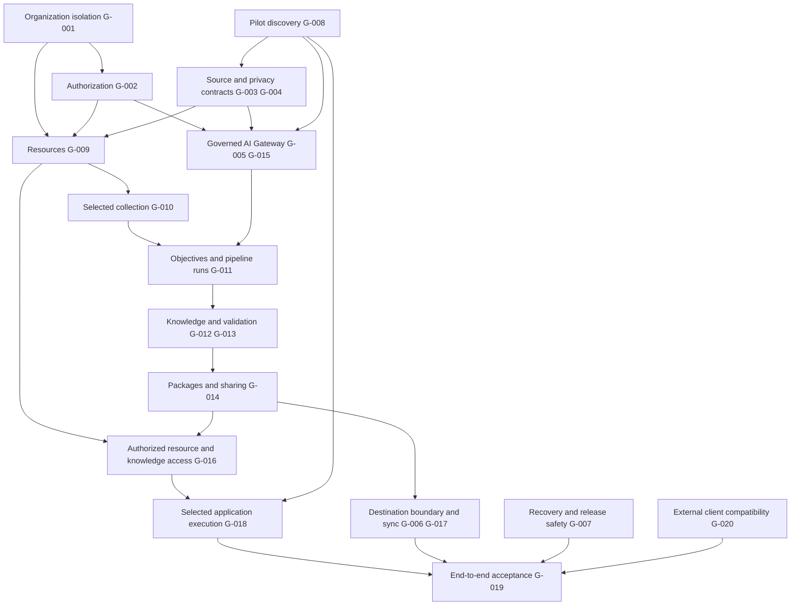

# Panadan Knowledge Platform — Gap Analysis

Date: 2026-11-26
Status: Phase 2 — proposed gap priorities and dependency assessment, awaiting owner review. Not an approved PRD, architecture, data model, roadmap, deployment or new decision.

## 1. Evidence, scope and method

- Authorized branch: `feature/knowledge-platform`.
- Starting HEAD: [e9d19a0c449df60326868d70c69fcf661088a6f9](https://github.com/aliinreallife/panadan/commit/e9d19a0c449df60326868d70c69fcf661088a6f9), the documentation-only Phase 1 audit commit.
- Source baseline audited in [CURRENT_STATE.md](CURRENT_STATE.md): [89cae80b3683cb73abe8a85710bff912fb9b580d](https://github.com/aliinreallife/panadan/tree/89cae80b3683cb73abe8a85710bff912fb9b580d). Application code is unchanged from stable baseline `44561cad16e17b7e60287dc8e0d7a7210fc5d32a`.
- Re-read the mandatory documents at the current HEAD: AGENTS.md, both DECISIONS documents, original PRD, STATUS, SECURITY, READ_ONLY, README and CURRENT_STATE. Rechecked the ingest/auth migrations, deterministic processor, auth-store selector, operator scope documentation, unified authorization design and Live OAuth rollout guidance.
- [DECISIONS.md](DECISIONS.md) is authoritative. All 21 public accepted decision entries (D-001–D-023, with intentional gaps) are traced below. No confidential/customer-specific details or intentionally omitted decisions are inferred or published. No new decision was approved in this task.
- Findings describe inspected source, historical CI, and documented operator observations, not independently verified current production. Phase 1 evidence and limitations carry forward. No tests rerun, workflows dispatched, credentials/customer data accessed or production changes performed. Other branches and external AI infrastructure are not assumed to be merged or available.
- `G-xxx` identifiers are local gap references, not D-xxx decisions. Priorities are reviewable recommendations; P0 does not mean stop all non-production prototyping. Each acceptance gate describes future evidence, not a test already passed.

| Priority | Meaning |
| --- | --- |
| P0 | Critical safety, integrity or release prerequisite. Blocks the affected real-data/live capability until addressed and verified. |
| P1 | Required for the accepted end-to-end MVP, with exact connector/application scope determined by pilot discovery. |
| P2 | Important post-MVP improvement, or capability conditional on evidence and scale beyond the minimum. |
| P3 | Future enhancement; not a commitment to build. |

## 2. Executive assessment

Panadan already has a reusable web/auth/reporting/MCP system and an independent PostgreSQL data-ingestion foundation. The primary architectural gap is not lack of a framework: it is the lack of an organization-aware, authorization-enforced knowledge lifecycle on top of the existing foundation.

The current reporting path reads one fixed source view directly. The owned database contains source records, raw revisions, processing jobs, derived facts and checkpoints. These are useful primitives for Resources and processing, but not a knowledge base, resource permission boundary, AI Gateway or application executor.

Recommendations for review:
- Reuse the existing FastAPI/Jinja/JS shell, reporting adapter, session/token mechanisms, permission intersections, MCP transport, PostgreSQL ingestion primitives and operational tooling.
- Make tenant and authorization boundaries explicit before adding broad new data access or background AI execution.
- Keep incoming source replication separate from outbound authorized knowledge projection. Never grant source writes merely to implement a destination feature.
- Preserve existing reporting/auth/API/MCP contracts. Use additive, reversible changes; avoid a parallel replacement platform or unapproved auth-provider/database cutover.
- Select the smallest pilot vertical slice only after discovery. Do not assume particular applications, providers, connectors, volumes, budget or quantitative success targets.

## 3. Decision-to-gap traceability

| Accepted decision | Current implementation vs target | Related gaps |
| --- | --- | --- |
| D-001 Resources | Raw revisions and derived facts preserve some lineage; no logical resource with optional representations, types, policies or independent resource serving. | G-004, G-009, G-010 |
| D-002 Infrastructure First, Application Enabled | Existing reporting product and ingest primitives; missing reusable knowledge/application boundaries. | G-001, G-009–G-018 |
| D-003 Risk-based hybrid validation | Deterministic normalization and optional numeric confidence are not risk classification, evidence or human review. | G-005, G-013 |
| D-004 Hybrid Knowledge | Raw record revisions are not independently versioned contextual claims or collections. | G-012, G-014 |
| D-005 Hybrid Storage | JSONB and source IDs exist; no generalized stored/referenced/synchronized representation policy. | G-004, G-009, G-010 |
| D-006 Designated pilot | Pilot direction accepted; operational requirements and data rights not established by repository. | G-008 |
| D-007 Panadan authority / one-way sync | Incoming Odoo-to-owned-PG mirror only; no authoritative knowledge lifecycle or customer destination export. | G-006, G-012, G-017 |
| D-008 Hybrid Discovery | Fixed metadata normalizer; no objective-driven AI discovery or bounded exploratory processing. | G-011, G-015, G-022 |
| D-009 Hybrid Processing | Durable jobs and sync timer templates; no generalized scheduled/manual pipeline runs and failure policy. | G-007, G-011, G-023 |
| D-010 Assisted Self-service | Admin UI and operational scripts exist; no repeatable workspace setup, scoped configuration or deployment-team workflow. | G-018, G-024 |
| D-011 Private / Shared Knowledge | Global account/source namespaces; no private-by-default tenant policy or explicitly shareable knowledge. | G-001, G-004, G-014 |
| D-013 Knowledge Packages | No package/version/membership or permission-aware package consumption implementation. | G-014, G-016 |
| D-015 Hybrid Applications | Reporting dashboard and external AI connections exist, but no configurable shared application execution. | G-018, G-025 |
| D-016 Hybrid Access Control | Role templates, field grants, token snapshots and per-client consent exist; no tenant/row/resource/worker scope. | G-001, G-002, G-005, G-016, G-020 |
| D-017 End-to-end vertical slice | Components available independently; no selected source-to-validated-knowledge-to-application-to-distribution acceptance path. | G-008, G-019 |
| D-018 Use Case-driven Infrastructure | Generic source schema is a useful start; actual pilot needs and reuse criteria must drive scope. | G-008, G-019, G-024 |
| D-019 Controlled Agentic Architecture | Fixed processor and read-only external MCP tools; no controlled internal AI execution or scoped application agents. | G-005, G-011, G-015, G-018 |
| D-020 Centralized multi-model AI Gateway | No internal provider calls, model configuration, usage/budget ledger or output validation in inspected branch. | G-005, G-015, G-025 |
| D-021 Evidence-based Knowledge Validation | Raw provenance exists, but no evidence-backed contextual validation, source authority or conflict policy. | G-012, G-013 |
| D-022 Core + Extensible Attributes | Generic JSONB payloads exist; no typed validated schema extension or temporal/context matching. | G-009, G-012, G-013 |
| D-023 Shared Core + Organization Workspace | Reusable web/data core exists; no organization isolation, configuration ownership or reusable app deployment. | G-001, G-002, G-018, G-024 |

## 4. Critical gaps — P0

| ID / gap | Current evidence and risk | Proposed closure / verification | Dependencies |
| --- | --- | --- | --- |
| G-001 Tenant/workspace isolation | Auth users are global and ingest primary keys are source-key based, not tenant-bound. No organization memberships, tenant FK/RLS policy or cross-tenant tests found. See `database/migrations/{001_multisource_foundation,003_auth_foundation}.sql`. Cross-customer reads or writes are possible if existing APIs are naively generalized. | Define a trustworthy organization context and membership; scope resource, knowledge, integration, application and audit ownership; enforce it on reads, writes, aggregates, search, jobs, exports and caches. Negative tests with two synthetic organizations including forged IDs, nested references and worker execution. Exact schema/isolation mechanism reserved for architecture/data model. | G-008 for policy details; can design generic isolation before customer discovery is complete. |
| G-002 Unified authorization and grant integrity | `server/security.py`, `security_pg.py`, `field_permissions.py`, `main.py`, `mcp_tools.py`: current intersections are reusable but field projection is mostly post-query, operator filters are not row security, malformed capability JSON can fall back to role defaults, legacy NULL grants preserve defaults. | Central policy contract for identity, organization, resource/row, operation, fields and client scope; no grant beyond grantor; request/worker rechecks, fail closed, explicit legacy migration semantics. Test privilege escalation, revoked user/client/field, unconsented client, malformed grants, filters/aggregates/existence leakage, direct-ID and query-level minimization. Preserve valid legacy behavior until separately reviewed. | G-001; G-020 for external client/runtime details. |
| G-003 Source identity, read-only and sync correctness | `server/database.py`, `odoo_sync_adapter.py`, `odoo_sync_coordinator.py`, `odoo_sync_pilot.py`, READ_ONLY, ODOO_WRITE_DATE_PILOT. Existing explicit read-only transactions, keysets and checkpoints are useful. Historical schema CREATE grant, stable-ID/duplicate and joined-change marker semantics, timezone, deletion feed and cross-stream freshness unresolved. | Obtain approved source contract and sanitized DBA evidence; dedicated least-privilege reader or equivalent verified grants; prove stable identity, source update coverage, ordering and safe deletion/retention handling. Test duplicates, tied timestamps, out-of-order events, interruption, replay, source disappearance and permissions. Never infer deletion from partial page. Blocks affected real-source ingestion, not synthetic work. | G-008, G-004; no production grant changes authorized. |
| G-004 Data rights, privacy, representation and retention boundary | Raw revisions persist history; transcripts may retain spoken sensitive details despite masking; no organization-specific data policy or complete purge lifecycle. `platform_ingest.py`, `transcript_ai.py`, SECURITY, runtime roles. | Obtain data-owner authorization per source, field, storage mode, purpose and provider; define classification, least collection, retention/deletion, evidence invalidation, backups and authorized sharing. Test no unapproved raw fields in AI/logs/exports; trace deletion and revocation through derivatives and packages, including retained historical versions. Redaction is not anonymization. | G-001, G-002, G-008; G-009/G-012/G-014 implement lifecycle. |
| G-005 AI execution and disclosure boundary | MCP gives external agents data access, not internal provider governance. No central AI policy, budget/time limits or approval boundary; input text may contain untrusted instructions. | Before real-data model use or agent actions: approved provider and data policy; treat input/evidence as untrusted data, allowlisted tools, structured output validation, strict scope, resource limits and human approval for consequential actions. Tests for prompt injection, attempted scope escalation, unapproved provider/fallback, timeout and budget exhaustion. | G-001, G-002, G-004, G-015. |
| G-006 Destination write boundary | Source DB is read-only by existing policy; no separate authorized destination integration. | Before outbound writing: explicitly approved destination, isolated secret and narrow role, fixed projection/write contract, validated-version eligibility, idempotency and revocation/deletion policy; test source write denial, cross-tenant export denial and replay. No arbitrary SQL or bidirectional editing. | G-001, G-002, G-004, G-012, G-017. |
| G-007 Release safety, operational recovery and run visibility | Existing CI, guarded controller, backup templates and health reader; current host config, recovery freshness, deployed revisions and scheduler not independently checked. Queue failure can leave work pending without persisted failure count; generic audit failures are swallowed. | Before affected production rollout: read-only operator evidence of pinned image/config and least-privilege roles; independent restore, rollback rehearsal, monitored audit/job/backup failure and safe kill/disable controls. Run isolated full test suite and restore tests on candidate; verify existing reporting still works. | G-003/G-004 for real data; G-011/G-019 for candidate. |

## 5. MVP gaps — P1

The following are capabilities required by accepted direction, not a finalized implementation checklist. Discovery determines selected sources, target users, applications, policy detail and acceptance metrics.

| ID / gap | Existing reusable assets | Minimum closure and acceptance evidence | Depends on |
| --- | --- | --- | --- |
| G-008 Pilot discovery and measurable scope | Source audits, existing product workflows, accepted pilot decision. | Confirm data inventory and rights, sample quality/semantics, current workflows, owners/users/access, pain points, destination, measurable benefit and one or more candidate vertical slices. Record customer details only in approved private context. Choose real use case(s) with owner, not from examples. | None; Phase 3 after review. |
| G-009 Logical Resources and typed extensions | sources/source_records/raw_revisions/derived_facts; deterministic normalization. | Organization-owned resource identity, source provenance, optional representations, original/version links and validated type-specific attributes; distinguish absent/unknown from present data. Resource lookup/browse independently from knowledge; prove original preserved and version history inspectable. | G-001, G-002, G-004, G-008 |
| G-010 Selected collection and hybrid storage | Odoo adapter, generic ingestion event API/library, JSONB and checkpoints. | Integrate approved minimal selected sources (call data plus selected online and/or manual inputs per discovery), including metadata and available representations. Explicit store/reference/sync policy per type; source credentials remain separate; bounded ingestion, manual import validation and error handling. Do not invent unavailable audio or transcripts; no object store required by default. | G-003, G-004, G-008, G-009 |
| G-011 Objectives, pipeline configuration and runs | processing_jobs, process_next, sync timers. | Configure objectives, scoped inputs, versions of stages/model/validation policy, scheduled/on-demand runs, run state, provenance, idempotent replay, bounded retries/backoff and cancellation/disable. Keep AI calls out of long-held SQL locks/transactions; define lease/recovery or simpler equivalent later. Tests for crash, timeout, duplicate execution, source change and revocation during run. | G-001, G-002, G-007, G-009, G-015 |
| G-012 Atomic contextual knowledge and lifecycle | Raw revisions, derived fact references. | Explicit independently versioned knowledge unit, subject/claim, typed conditions, temporal validity, source/evidence links, validation state and access policy. Preserve history, record supersession and distinguish unknown vs incompatible conditions. Only validated eligible version distributed as authoritative. Exact schema/state machine pending Phases 5–6. | G-001, G-002, G-004, G-009, G-013 |
| G-013 Evidence-based/risk-based validation | Deterministic transformation, source audits; confidence column only. | Explicit versioned validation rules, subject-specific authority, freshness, contextual comparability, evidence inspection, conflict resolution and human review where risk requires it. Synthetic tests: different dates/room/occupancy/currency are not automatically contradictory; missing context remains unknown; matching scoped contradictory claim is flagged; low evidence/high risk cannot auto-publish. Model confidence is not evidence or risk. | G-004, G-008, G-009; co-design G-012 |
| G-014 Knowledge Packages and minimal sharing | No package implementation; source revisions can supply evidence pointers. | Version-aware collections referencing units, not uncontrolled duplicate text; private default, explicitly authorized shared content only, recheck underlying source/knowledge access on consumption. Test stale/revoked member, cross-org denial, approved sharing and package reproducibility. | G-001, G-002, G-004, G-012, G-013 |
| G-015 AI Gateway | No local gateway in audited branch; assess separately available AI API infrastructure before duplicating. | One governed invocation interface, approved providers and explicit model per task/pipeline, privacy-aware allowed fallback, typed/validated outputs where required, per-org/run/task usage and cost, timeout/step/token/budget limits. Support multi-model configuration without smart routing. Test fake providers, structured output failure, timeouts and budgets. Exact provider/model and reuse integration not selected. | G-005 (co-designed), G-008, G-001/G-002 |
| G-016 Authorized distribution and independent retrieval | REST/MCP/Web, self-access, field projection, consent. | Resource and knowledge retrieval exposed independently through scoped web/API/MCP; current policy enforced before retrieval and projection; validated-only authoritative knowledge with evidence/context/freshness; no generic query or expanded sensitive legacy tool without review. Verify cross-surface parity, revocation and compatibility. | G-001, G-002, G-009, G-012, G-013, G-014, G-020 as needed |
| G-017 One-way knowledge destination sync | Incoming mirror and checkpoints are reusable concepts, not destination implementation. | Export a selected authorized validated projection to approved customer destination, version/idempotency key, bounded retries/checkpoints, failure/status audit and reconciliation/revocation contract. Verify duplicate export, stale version, disabled grant, failure/recovery and source immutability. Exact destination contract is pilot-dependent. | G-006, G-008, G-012, G-013, G-014 |
| G-018 Workspace configuration, application engine and selected apps | Existing reporting UI, web runtime and permission controls. | Minimal workspace UI/configuration for authorized users/deployment team, integration/objective/pipeline/package/application settings; configurable app runner accepting permitted resources and knowledge separately, deterministic operations where appropriate, controlled agent limits/approval. Deliver selected ready-made applications with real workflow acceptance. Do not assume customer intelligence/content intelligence confirmed. | G-001, G-002, G-008–G-016 |
| G-019 End-to-end validation and observability | CI, synthetic PG suite, metadata audit, admin health. | One real-purpose vertical slice using synthetic or explicitly approved data: ingest -> resources -> configured run -> evidence-backed knowledge -> package/app/API/MCP -> approved one-way export. Track reliability, provenance, freshness, access isolation, export correctness, cost and user outcome. Prove existing reporting unaffected and a second synthetic organization can be configured without a core fork. Quantitative targets after discovery. | G-007–G-018 (selected scope), G-020 if external OAuth required |
| G-020 External authentication/runtime compatibility | SQLite production default, PG staging store, manual MCP bearer, external JWT verifier, consent/discovery gate. | Preserve existing modes; prove approved external clients can connect, scope, retrieve and revoke via supported authentication. If pilot requires live OAuth, complete separately reviewed issuer/audience/signed-client/consent/PKCE and rollback gates, not just tool discovery. Current auth migration and candidate provider changes are not automatic MVP requirements. | G-001, G-002, G-007, G-008; G-021 if runtime migration needed |

## 6. Post-MVP and future gaps

| ID / priority | Capability | Reason to defer / revisit trigger |
| --- | --- | --- |
| G-021 / P2 (conditional P0 release dependency) | Production PG auth cutover or external identity-provider replacement | Existing auth runtime works within legacy boundaries. PG selector deliberately only supports isolated staging. Consider only if tenant architecture/pilot/operations demonstrate need; any chosen cutover requires frozen writes, parity, recovery and rollback. Do not assume a provider or merge another branch. |
| G-022 / P2 | Expanded exploratory discovery | Keep MVP goal-driven and any exploratory discovery bounded. Broader autonomous discovery requires measured quality/cost, scope enforcement, evidence review and demonstrated value. |
| G-023 / P2 | Event-driven orchestration, richer queue/scale infrastructure | Scheduled/manual first; introduce events, queue broker or distributed workers only on measured latency/throughput or reliability requirement. Baseline bounded reliable execution is P1, not deferred. |
| G-024 / P2 | Broader connector catalog and customer self-service onboarding | MVP assisted setup, selected sources, reusable configuration and one additional synthetic workspace proof. Broader connectors/config builders only after repeated needs, support and security evidence. |
| G-025 / P3 | Visual workflow/agent builder, advanced graph, dynamic AI routing | Explicitly deferred. No speculative graph/vector infrastructure, unrestricted agents or automatic public content publishing. Reassess only with validated use cases and separate approval. |
| G-026 / P2 | Advanced platform observability and resilience | Baseline auditing, backup/restore, run health and safety gates remain P0/P1. Broader SLO automation, scaling, dashboards and operational optimization follow measured workload. |

## 7. Architectural conflicts and technical debt

| Finding | Consequence | Proposed treatment (not architecture decision) |
| --- | --- | --- |
| Fixed single-view reporting queries and global authorization versus D-016/D-023 | Existing filters cannot express trusted tenant/row scope; output projection alone is insufficient. | Keep legacy reporting isolated and compatible; establish common policy boundary and scoped repositories for new domains. Refactor existing paths incrementally where necessary; no unrestricted query endpoint. |
| Auth and ingest schemas have no shared organization boundary | A source key or local user ID cannot establish ownership; separate stores complicate membership/revocation consistency. | Compare an additive current-store approach with reviewed owned-PG auth migration in architecture phase. Keep one authoritative identity store; no accidental dual-write or fallback. No forced cutover now. |
| Ingest processor and fact model versus knowledge claims | Current normalization facts can be updated under same processor/revision key and do not record validation lifecycle or intended-use risk. | Reuse as resource derivatives; add separate knowledge concept and evidence links rather than relabeling derived_facts as validated knowledge. |
| Source read-only policy versus D-007 export | Broadening source connection would violate security constraints. | Separate destination configuration, credentials and narrow projection. This is a boundary requirement, not a conflict in product decisions. |
| Existing sync cursor and tombstone semantics versus retention/freshness | Checkpoints do not establish cross-stream causal ordering; deletion markers do not physically erase data. | Require source contract and lifecycle/reconciliation design; do not promise exact-once processing or complete deletion without evidence. |
| Processor transaction model versus AI workload | Holding row locks across provider calls risks contention; rollbacks can leave poison jobs pending. | Reuse durable job primitive but separate long-running execution and final commit with verified scope/version; design retries and durable failure state. |
| Legacy grants and transcript behavior versus least privilege | Historical docs and current raw transcript projection differ; default legacy grants and malformed overrides need explicit review. | Preserve valid contracts, review behavior and negative tests, explicitly migrate grants, never relax transcript privacy as incidental compatibility fix. |
| Monolithic main.py and duplicated SQLite/PgStore methods | Future domains can amplify coupling and policy drift. | Organize new features behind explicit modules/interfaces; shared policy logic where practical; only refactor old modules with regression evidence. No rewrite required. |
| Public repository versus private deployment discovery | Runtime configurations and customer requirements cannot be freely committed. | Public docs use abstract/synthetic examples; private deployment evidence kept separately under authorization. |
| CI/build and deployment evidence drift | Successful build/CI does not identify live image or active auth/mirror configuration. Manual image dispatch can publish moving main tag. | No dispatch in this phase; use pinned artifacts and safe operator evidence; separate release approval. |

No accepted product decision requires reopening based on current evidence. The issues above are implementation gaps and pending design choices.

## 8. Dependencies and sequencing constraints

This is a dependency sketch for review, not Phase 7 roadmap or implementation order approval. No cyclic dependency is intended: G-005 and G-015 are co-designed policy/interface, G-012 and G-013 are co-designed knowledge/validation. Initial synthetic work can proceed later without live approvals; real data and writes are gated.

Important ordering constraints:
- Obtain discovery evidence before freezing app scope, source schemas, provider choice or business KPIs.
- Define organization/permission scope before broadening data retrieval or executing real customer pipelines. Keep it mandatory for background jobs as well as HTTP.
- Resources precede evidence-backed knowledge; validation precedes authoritative distribution. Resources remain independently consumable by authorized apps/agents.
- Use deterministic source normalization independently of model calls. AI output is a proposal until the applicable validation policy is satisfied.
- Export only after destination approval, knowledge version eligibility and failure/revocation policy. Do not let an external app overwrite authoritative knowledge indirectly.
- Production readiness is a separate gate, not a prerequisite to discussing or testing synthetic designs.

## 9. Migration considerations and rollback requirements

No migration is executed, and no final schema or deployment topology is chosen here.

| Boundary | Required future migration approach / verification |
| --- | --- |
| Identity and organizations | Inventory existing user IDs, roles, grants, token snapshots, sessions and OAuth subject/client links. Map existing users to a reviewed legacy workspace without automatically widening grants. Preserve stable identity and current auth authority; compare alternatives for tenant membership storage. Test imported and newly created accounts, revocation, rollback and old token behavior. |
| Source and ingestion | Inventory existing owned PG source registry, keys, revision counts, streams and job versions by metadata only. Add organization ownership and scoped identities using additive migration or compatibility layer; verify mapping, constraints and parity before cutover. Do not collapse duplicate IDs without source contract; preserve raw revision provenance. No mutation of source DB. |
| Resources and knowledge | Keep existing raw/derived history; introduce new representations, typed attributes and knowledge versions without fabricating evidence or inferred contexts. Test migration rerun, backfill restart, referential integrity, source deletion/retention and version resolution. |
| Legacy reporting/API/MCP | Maintain current stable route/tool names and legitimate behavior; add explicitly scoped interfaces. Test existing client integration, filters, negative permission cases, response compatibility and rollback. Review any intentionally changed security behavior with owner. |
| Jobs and exports | Migrate/disable schedulers deliberately, preserve durable checkpoints, prevent duplicate processing/export, keep previous run/config versions available under retention. Failure/restart must not advance cursor without committed data. Disable new outbound jobs on rollback; do not blindly reverse customer-side writes. |
| Data stores and releases | Additive schema first; isolated synthetic migration and restore rehearsal; approved backups with verified recovery keys; pin candidate/rollback images, retain legacy data/read path and documented feature disable controls. Any destructive cleanup, auth cutover or production release needs separate authorization. |

## 10. Evidence needed before final MVP PRD

| Open question | Why it matters / evidence sought |
| --- | --- |
| Actual user workflows and outcomes | Which task is painful, who owns it, what is a successful outcome, how is it measured today? Prevent speculative apps. |
| Approved source inventory and rights | Source systems, available interfaces, update/delete/ID semantics, accessible data types, volume/freshness, sample quality and lawful access. No raw customer data in public repository. |
| Resource representation policy | Are originals available and needed? Can audio be referenced instead of copied? Who may see transcripts/analysis? What retention applies? |
| Knowledge objectives and risk | Which claims/questions matter, which sources are authoritative for which subject, what context/freshness is required, what needs human review? |
| Access model | Actual groups, workspace membership, row/field/source restrictions, external agents, grant/revocation responsibilities and sharing rights. |
| AI providers and data rules | Existing separately available AI gateway/API, approved vendors/models, allowed data, budget/latency constraints, output validation. No provider selection in this phase. |
| Application and destination | Selected workflow, authorized outputs and consumers, destination DB/API contract, projection/version/revocation semantics and customer approval. |
| Runtime/operations | Current deployed revision, OAuth mode/client compatibility, owned PG roles/schema, source grant audit, mirror health/parity and backups/restore. Metadata evidence only; no production action. |
| Acceptance metrics | Baseline and target for quality, ingestion reliability, freshness, throughput/cost, task outcome, isolation, export and support effort. Do not invent thresholds. |

## 11. Phase exit

The accepted direction can be pursued without discarding the existing product. Critical safety gaps, MVP capability gaps, dependencies, debt and migration considerations are now recorded for review.

Recommended next phase: pilot discovery with the product owner, using actual workflows and source/permission facts to define a limited end-to-end scope. Customer Intelligence and Content Intelligence remain candidates only. Keep sensitive customer discovery outside this public repository.

No application code, database, deployment, decision register or other branch is modified by this document. Do not begin Phase 3 until the owner reviews/authorizes progression. Do not start implementation or approve architecture/data model from this gap analysis.
