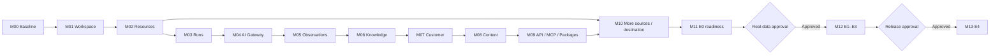

# Panadan Knowledge Platform — Implementation Roadmap

| Field | Value |
| --- | --- |
| Version | 0.1 — Phase 7 review |
| Date | 2026-11-26 |
| Status | Roadmap approved in D-067; synthetic Phase 8 through M11 authorized in D-069 |
| Baseline | 18e39b7ad992758115ca12fb3cbee936eb48343a |
| Authorized branch | feature/knowledge-platform |
| Accepted direction | D-001–D-069 (67 public accepted entries; intentional numbering gaps) |
| Approved design | [PRD](PRD.md), [Architecture](ARCHITECTURE.md), [Data Model](DATA_MODEL.md), [UI direction review](UI_DESIGN_REVIEW.md) |
| Implementation | Synthetic M00–M11 authorized and dependency-gated. See [IMPLEMENTATION_STATUS.md](IMPLEMENTATION_STATUS.md) for actual evidence. |

## 1. Delivery strategy and constraints

This roadmap converts approved scope into dependency-ordered increments. It is not an authorization to run production commands, copy real data, pay providers, publish an image, open a PR, merge or deploy. All estimated order, milestone grouping and proposed responsibilities are planning recommendations; no calendar deadline, staffing level, budget amount or delivery date is assumed.

Read [AGENTS.md](../../AGENTS.md), [DECISIONS.md](DECISIONS.md), [CURRENT_STATE.md](CURRENT_STATE.md), [GAP_ANALYSIS.md](GAP_ANALYSIS.md), [PRD.md](PRD.md), [ARCHITECTURE.md](ARCHITECTURE.md), [DATA_MODEL.md](DATA_MODEL.md), [UI_DESIGN_REVIEW.md](UI_DESIGN_REVIEW.md), [README](../../README.md), [historical decisions](../DECISIONS.md), [original PRD](../PRD.md), [STATUS](../STATUS.md), [SECURITY](../SECURITY.md), [READ_ONLY](../READ_ONLY.md), [DATA_DICTIONARY](../DATA_DICTIONARY.md) and [PRODUCTION_OPERATIONS](../PRODUCTION_OPERATIONS.md) before implementing affected work. Accepted decisions are authoritative; record newly approved changes immediately with stable IDs. Do not silently treat proposed implementation details as accepted.

- Build a modular monolith with separately scoped workers on the existing Python/FastAPI, owned PostgreSQL 18-compatible and MCP SDK foundation. Preserve existing reporting, authentication and external access. No speculative infrastructure or rewrite.
- Work in small, reversible, tested increments on the authorized branch. Keep main and backup unchanged unless explicitly authorized otherwise. No source writes, no source schema changes, no automatic import or auth cutover.
- Security and privacy are prerequisites, not a final polishing phase. All real source/AI/client/destination activations are disabled by default and independently approved. Source owner retains their data; local redaction, retention and erasure are separate.
- Use synthetic fixtures and mocked providers first. One synthetic operator/30-day fixture for the first scenario; a second synthetic workspace proves reuse/isolation. First real pilot only one approved operator and most recent 30 days of eligible calls. No automatic older window or additional operator.
- Deliver backend, database, usable RTL UI and tests together per vertical slice. Preserve approved visual direction D-066; no need to implement all screens before the first useful synthetic flow.
- Implement the approved data-model inventory incrementally. Avoid creating every table at once. Where an FK refers to a later module, introduce minimal parent tables or defer the dependent feature to its owning increment; add reviewed constraints before enabling it. Never use unconstrained temporary production grants or orphan tenant rows.
- Do not treat feature-branch push as CI pass: current CI triggers on PR and main. Use local isolated verification and approved CI strategy; record actual skips/failures. No real customer data, private approval records, credentials or reference image in public Git history.

## 2. Milestones and critical path

| ID | Milestone | Dependencies | Completion result |
| --- | --- | --- | --- |
| M00 | Baseline and implementation harness | Phase 7 approval, explicit M00 authorization | Reproducible baseline, test environment, change boundaries |
| M01 | Workspace security and owned schema | M00 | Two isolated synthetic tenants, identity bridge, scoped shell |
| M02 | Call Resources and privacy | M01 | Synthetic read-only call collection, filtered revisions, resource explorer |
| M03 | Objectives, pipelines and durable runs | M01/M02 | Configured bounded run with fake deterministic processor |
| M04 | AI Gateway, budgets and provider adapter | M01/M03 | Mocked governed execution and reconciled budget ledger |
| M05 | Observations, evidence and aggregation | M02/M03/M04 | Source-level extraction and reproducible scoped counts |
| M06 | Knowledge validation, review and taxonomy | M05 | First authoritative synthetic contextual finding |
| M07 | Customer Intelligence | M06 | Useful scoped feed/dashboard on shared query services |
| M08 | Content Intelligence | M06/M07 | Evidence-backed opportunities and briefs via same knowledge |
| M09 | Packages, sharing, API and MCP | M06/M07/M08 | Authorized independent retrieval and pinned packages |
| M10 | Additional sources and destination sync | M02/M06/M09 | Manual/web fixtures and separate idempotent synthetic destination |
| M11 | Integrated MVP readiness / E0 | M00–M10 | Full synthetic acceptance, security, recovery, UX and operational proof |
| M12 | Approved real-data pilot E1–E3 | M11 + separate activation approvals | Measured technical, semantic and business results within scope |
| M13 | Production readiness and bounded operation E4 | M12 + separate release approval | Reviewed rollout/rollback, operational monitoring and approved continuation |

M00–M11 are the implementation and synthetic verification portion; M12–M13 depend on private operational authorization. The first meaningful vertical slice is M00→M01→M02→M03→M04→M05→M06→M07, followed by M08, then broader MVP completion. M07 does not by itself constitute full MVP acceptance. Manual/web adapter work in M10 can be prepared after M02 and destination work after M06/M09, but integrated acceptance requires both. UI specifications can be prepared ahead in parallel, not live integration or unsafe data work. Baseline audit, retention and authorization tests are progressive across milestones, not postponed to M11. M09 early query-service and client-compatibility scaffolding may begin earlier; no external client access before its gate. M12 sample stages are gated separately, not one blanket approval.

## 3. Execution protocol and definition of done

Every milestone contains candidate small increments below. Before each increment, fetch current branch HEAD, review affected requirements, code and tests, and identify acceptance and stop conditions. D-069 authorizes synthetic implementation through M11 as each prerequisite passes. Seek a decision for substantive unresolved product, architecture or security conflicts. Real source and provider contracts require separate approval.

For each increment: (1) verify clean or understood working state and protected refs, (2) review proposed schema/DTO/security contracts and design screens, (3) implement bounded change with additive migrations and tests, (4) run targeted and applicable regression/integration suites, (5) verify diff and commit only authorized branch, (6) report commit, changed files, tests with actual results/skips, limitations, security and rollback, and remaining tasks, (7) update a knowledge-platform implementation status ledger and affected docs based on evidence, not optimism. Establish the ledger during M00; do not overwrite historical reporting STATUS.md indiscriminately. Never mark a failed or skipped required test passed. Failed gate blocks dependent activation. Partial work is labeled partial. Proposed state labels: not started, in progress, blocked, implemented unverified, verified synthetic, verified authorized pilot, released. Approval and verification are distinct.

Definition of done for a code increment: requirements traced; security/default-off and source immutability preserved; applicable DDL/FK/RLS/replay tests passed on disposable DB; versioned contracts and migration guard reviewed; synthetic UI interaction/accessibility checked if user-facing; legacy regression tested; no raw/private data or secrets in diff/logs; clear operational failure and rollback; actual evidence recorded and commit verified. Documentation-only changes need diff/consistency verification, not fictitious software test results.

Test commands from current README/CI: `./panadan.sh verify` for locked Python/Node and syntax, `./panadan.sh verify --docker --assets` for full local pre-merge gate including ephemeral synthetic PG18 and assets where available; `uv sync --locked --dev --python 3.13`, `uv run --locked python -m pytest -q`, `npm test`, `npm ci` and `npm run build`. Confirm current script behavior and disposable target before invoking; do not run setup, source audits, sync CLI, deploy controller, production migrations or reset commands against actual infrastructure by implication. CI platform integration currently lists selected legacy tests explicitly; include new relevant test files in reviewed CI coverage. PR-triggered Docker build only if authorized. A missing local tool/network/runner is a blocker to required evidence, not license to bypass checks.

## 4. Detailed implementation backlog

Each row is a proposed increment boundary (split further if needed). Task IDs stable within roadmap, not canonical product decisions or external issue IDs. All tasks initially not started.

### M00 — Baseline and implementation harness

| Task | Scope and output | Exit evidence |
| --- | --- | --- |
| M00.1 | Fetch branch and protected refs; inspect current tree, test commands, migration scripts, auth/ingest contracts, CI and private-config requirements; map reuse/extend/build | Baseline revision and documented actual risks; no production query |
| M00.2 | Reproduce locked local test environment with synthetic-only disposable PG18 and mocked source; run existing suites/assets as available; capture baseline failures/skips | Actual baseline test log and environment; no secrets or live DSN |
| M00.3 | Establish feature flags/default-off contract, implementation status ledger, migration review convention and synthetic fixture plan; map test suites and review checkpoints | Explicit implementation boundaries, approved next increment plan |

Baseline failures: reproduce and classify before changing functionality; do not hide or casually fix unrelated defects. If test infrastructure is unavailable, report exact limitation and obtain suitable environment before declaring baseline verified. Verify existing source privilege risk only from historical evidence at M00; live read-only grant audit is a separately authorized later action. Initial UI track: inventory current shell/design components, synthesize token/RTL conventions from approved direction and create a reviewable screen backlog. No new application code required in M00. Gate G0: baseline and test harness reviewed, no unresolved blocker to M01.

### M01 — Workspace security and additive owned schema

Dependencies: G0. Covers FR-01, NFR-01/10, DM-01/02, AP-03/04, G-001/002; legacy compatibility groundwork.

| Task | Scope and output | Exit evidence |
| --- | --- | --- |
| M01.1 | Review exact schema/migration numbering and owned-DB guard; add panadan_knowledge workspace/principal/membership/policy foundation, tenant PK/FK and minimal audit | Clean + existing-schema disposable migration tests; no legacy assignment; source untouched |
| M01.2 | Implement stable identity adapter and authoritative workspace grant store; explicit capability/scope resolution, role templates, revocation epoch, deny malformed grants; preserve existing identity backend | Synthetic account binding/recreation/revocation tests; no silent auth fallback or new legacy reporting grants |
| M01.3 | Add narrow role grants/RLS and trusted per-transaction scope; pooled context reset, no arbitrary SQL; service identities and restricted scheduler metadata path as needed | Cross-tenant negative tests including direct IDs, composite references, missing context and exception reuse |
| M01.4 | Add scoped web shell, workspace switch/overview, member and access views with approved visual direction; synthetic only, route guards and state/access testing | Two synthetic workspaces, same IDs, independent configuration; legacy routes preserved |

Do not introduce FK-dependent sharing/package tables until parents exist; create resource-scoped grant relations when sources are added before using them. Narrow privilege review is mandatory. If identity bridge fails stable mapping or revocation, stop activation and propose reviewed migration; no production PG auth cutover. Gate G1: AT-01/DM-T01 relevant subset, legacy auth/reporting regressions, no cross-tenant access or existence leak. Disable flags to roll back UI; preserve compatible DB additions.

### M02 — Read-only call collection and Resource Explorer

Dependencies: G1. FR-02–05, G-003/004/009/010, D-035–037/046/051/059.

| Task | Scope and output | Exit evidence |
| --- | --- | --- |
| M02.1 | Source registry, contract/field allowlist, operator scope, resource/representation schema and typed attribute versions; constrain source/contract/parent FKs; synthetic contract | Same-source parent constraints, unsupported source and unknown scope denied |
| M02.2 | Dedicated scoped read-only adapter with bounded parameterized queries to synthetic source; verify selection by stable operator and half-open event window; no broad legacy import | One operator/30-day synthetic boundary; ambiguous IDs/time fail closed; source write denial |
| M02.3 | Deterministic redaction/preprocessing before persistence, versioned rules and filtered text anchors; safe memory/log/error handling; review legacy excerpt mask without changing offsets | Persian/mixed-language leak canaries, no raw durable payload; unchanged original; residual-risk limitations documented |
| M02.4 | Checkpoints, source revisions, idempotent upsert, overlap/replay/CAS and exclusion outcome; minimal work intent; no inferred deletions | Late update, conflicting marker, duplicate event, tombstone, scope change and failure tests |
| M02.5 | Resource Explorer and Integrations UI: source/contract/sync scope, filtered representation and version lineage, status/history and access; no original edit/delete | Authorized and denied UX, provenance, missing/stale/partial and error states |

Real Odoo fields, stable IDs, event clock, change/delete semantics, actual privileges and load need private verification O-01/O-02/O-03; no actual source connection in this milestone. Existing raw ingestion schema is not a safe drop-in. Retention/availability and invalidation begin here; complete downstream propagation at M06/M09/M11. Gate G2: AT-02/03 call subset, DM-T02/03/04 with synthetic source. Disable connector and workers if unsafe; do not delete or mutate customer source.

### M03 — Objectives, pipelines and durable execution

Dependencies: G2. FR-06/07, G-011; DM-04.

| Task | Scope and output | Exit evidence |
| --- | --- | --- |
| M03.1 | Curated seven objective templates, typed configuration/versioning, simple custom objective and pipeline/source bindings; validate all refs and scopes | Invalid schema/source/version rejected; template editing creates version |
| M03.2 | Schedule occurrences, manual request identity, run manifest, frozen population membership and coverage; default off; separate collection vs extraction | Schedule dedup, window and operator bounds, unknown counts and scope change |
| M03.3 | Work items/attempts, lease/fence, retry wait, cancel/pause/resume, priority classes, short claim/finalize transactions and crash recovery | Parallel workers, stale fence, retry exhaustion, duplicate result and starvation/backfill scenarios |
| M03.4 | Objectives and Pipelines & Runs UI: template/custom form, scope/model placeholder or approved config, schedule, run preview, coverage, error and run history | Synthetic deterministic run without provider; no claim of paid execution |

Use fake deterministic task processor until M04; do not leave a direct path from pipeline to provider. Queue metadata references only, no raw payload. Provider binding FK and budget fields integrated when M04 parents exist before model activation. Gate G3: AT-04 orchestration subset and DM-T05. Pause/disable scheduler and workers; preserve completed state and reconcile leased attempts.

### M04 — AI Gateway and cost controls

Dependencies: G3. FR-14/15, G-005/015, DM-08, D-038/039/045/054/064.

| Task | Scope and output | Exit evidence |
| --- | --- | --- |
| M04.1 | Assess existing organizational AI gateway capabilities (approved documentation/fixtures; actual access separate); define adapter, provider/model config, disclosure policy and rate version | Written reuse decision proposal/evidence; no vendor selected without approval |
| M04.2 | Build common gateway with mock transport, strict typed output, bounded request, explicit credential/provider/model resolution and data-purpose policy | Denied data/provider never dispatched, injection-like input treated as data, invalid schema/timeout tests |
| M04.3 | Org/run accounts, request/reservation/usage/adjustment ledger; atomic dual-cap admission and deterministic lock order; reconcile uncertain timeouts and actual overrun | Concurrency test, retry charge, missing rate, uncertain reservation, no double counting |
| M04.4 | Integrate governed execution into pipeline and app task contract; preserve fence, recheck egress/result policy, no transaction over network | No direct provider bypass; stale/revoked results rejected; mocked end-to-end budget-block/resume |
| M04.5 | AI Gateway & Usage UI: authorized config, safe model metadata, cost attribution, cap controls and estimated/reported/unknown states | No secrets, no billing/BYOK; blocked run retains completed work |

No paid synthetic or real provider call without separate provider/data/budget approval. Actual intermediary/downstream terms and rate/precision/period/cap remain O-04/O-05. Existing AI gateway reuse remains conditional; do not duplicate blindly or assume compatibility. Gate G4: AT-08, DM-T10, AT-04 budget subset. Disable egress, stop new chargeable dispatch; preserve uncertain reservations and reconcile.

### M05 — Observations, evidence and reproducible aggregation

Dependencies: G2/G3/G4. FR-08/09, DM-05, G-011/012/013.

| Task | Scope and output | Exit evidence |
| --- | --- | --- |
| M05.1 | Implement versioned observation schemas and structured extraction contract for first six customer objectives; begin Customer Questions and Customer Concerns, extend within milestone to remaining four | Validated fixture output per objective; trusted IDs not accepted from model; unknown values explicit |
| M05.2 | Store observation sets, compatible objective mappings, exact filtered codepoint evidence anchors, attribution and extraction signature | Fabricated refs/offsets rejected; Persian/English span tests; compatible reuse, version mismatch and reprocess tests |
| M05.3 | Deterministic distinct-call population/aggregate membership with matched flag; count and denominator reconciliation, topic overlap and coverage | Exact fixture counts; duplicates/zero/unknown denominator/changed revision tests |
| M05.4 | Bounded semantic grouping and topic suggestions with governed mock task, no autonomous objective or taxonomy mutation; technical inspection UI within run/resource detail | Model cannot own counts; observation provenance/coverage inspectable |

Prior AI analyses not independent evidence; no audio ingestion, individual profiles or inferred revenue. KO-07 handled in M08 as derived validated-knowledge objective. Gate G5: AT-05, DM-T06/07; replay safe and no fabricated evidence. Disable affected task versions and suppress invalid results; preserve allowed history.

### M06 — Knowledge Engine, validation, taxonomy and review

Dependencies: G5. FR-10–12, G-012/013, DM-06/07.

| Task | Scope and output | Exit evidence |
| --- | --- | --- |
| M06.1 | Knowledge units/revisions, contextual claims, evidence links, current pointer, source authority, conditions/freshness and lifecycle | Parent/revision invariants and contextual conflict vs distinct offer fixtures |
| M06.2 | Versioned deterministic validation rules, reliability/prevalence/importance, risk-based review, reviewer rationale/history; bounded semantic assist only | Unsupported/high-risk/missing evidence cannot auto-publish; review does not bypass policy |
| M06.3 | Evidence invalidation and retention availability, dependency traversal and stale projection suppression; transactional transition/current pointer | Changed/revoked/expired evidence immediately unavailable, no silent resurrection |
| M06.4 | Versioned taxonomy/category suggestions, evidence-linked review and historical classification; unknown/unmatched and cycle checks | No autonomous mutation, stable category identity and version-aware counts |
| M06.5 | Knowledge Base, Evidence & Validation, Review Queue and Taxonomy UI; candidate vs active, conflict, scope, freshness and version history | Authorized review journey, readable evidence and statuses, no unauthorized excerpt/count leaks |

Exact risk rules, reviewer assignments and category seeds require scoped review O-06/O-07. Synthetic policy only until approved. Gate G6: AT-06, AT-07 taxonomy subset, DM-T08/09 partial; first authoritative synthetic finding traceable to evidence. Disable publication, suppress invalid revisions; no blind history deletion.

### M07 — Customer Intelligence vertical slice

Dependencies: G6. FR-16/17, G-016/018/019, D-024–026.

| Task | Scope and output | Exit evidence |
| --- | --- | --- |
| M07.1 | Shared scoped query services and customer app config; deterministic measures/filters, versioned DTOs and evidence permissions | Same counts as aggregate membership; source/period/coverage/metric definitions; denied filters fail safely |
| M07.2 | Customer Intelligence insight feed, limited dashboard and detail drill-down; responsive preferred design; workspace overview gains actual derived status | User moves from insight to permitted evidence, sees uncertainty, no unique customer/market claims |
| M07.3 | Synthetic end-to-end scenario from call to insight, audit and technical/domain review; regression and usability check | Demonstrate working vertical slice in isolated environment, not a live pilot |

Gate G7: AT-09 customer subset, AT-05/06 regression; first useful product demonstration. This is an intermediate success, not full MVP. No dedicated chat UI, individual profile or broad custom analytics builder.

### M08 — Content Intelligence and shared app execution

Dependencies: G6/G7. FR-16/18, D-027/034/042.

| Task | Scope and output | Exit evidence |
| --- | --- | --- |
| M08.1 | KO-07 Content Opportunities configuration; derive from authorized current validated knowledge; common governed run/model/budget | No separate call extraction silo; unsupported opportunities rejected |
| M08.2 | Opportunity/brief revisions, permitted evidence/knowledge refs, audience/goal/rationale/format/outline; invalidation and regeneration under policy | Brief becomes stale/unavailable after relevant knowledge changes; no unverified SEO volume |
| M08.3 | Content Intelligence opportunity list/detail and full brief UX, role-appropriate access and authorized MCP drafting handoff (actual client in M09) | Content specialist completes synthetic workflow; no editor, auto-publish or CMS |

Gate G8: AT-09 both apps with shared knowledge and reuse, mock cost and stale tests. Drafts outside Panadan not authoritative knowledge; human review before publication. Disable app feature or generation; preserve independent customer app.

### M09 — Packages, sharing, Web/API/MCP access

Dependencies: G6/G7/G8. FR-13/19, G-002/014/016/020, DM-07, AP-09.

| Task | Scope and output | Exit evidence |
| --- | --- | --- |
| M09.1 | Pinned package versions/member refs, private default, explicit recipient sharing projection and current policy/evidence checks | Package cannot elevate member access; stale/revoked version and cross-tenant tests |
| M09.2 | Shared authorized independent Resource and Knowledge read services exposed through versioned bounded REST and MCP contracts; scoped metrics, package/brief retrieval | Parity with web; no raw originals/unrestricted SQL, no existence leaks or arbitrary tool authority |
| M09.3 | Extend verified identity/client consent/grant mapping, independent external disclosure; protocol tests and synthetic approved client connection/discovery/invocation/revocation | Legacy bearer/OAuth/MCP regression and real-client compatibility evidence if separately authorized; unresolved external OAuth blocks relevant live claim |
| M09.4 | Knowledge Package Builder and API/MCP/Connections UI; preview effective grants/representations, version/status, revoke and errors | User sees actual permitted projection; no secret or silent expansion |

Use isolated local synthetic MCP tests before any actual external connection; actual client/network/consent activation requires explicit O-10 approval. No claim that current live OAuth works. Gate G9: AT-07/10 and DM-T09/01/12 relevant; approved client compatibility separately verified before real MCP. Revoke new grants/disable new endpoints while preserving old contracts.

### M10 — Limited extra sources and one-way distribution

Dependencies: Resource adapters after G2; outbound after G6/G9. FR-02/03/05/20, G-003/004/006/010/017, DM-09.

| Task | Scope and output | Exit evidence |
| --- | --- | --- |
| M10.1 | Bounded manual text/document adapter for approved formats; isolated parser, type/size checks and provenance | Synthetic supported fixture and denied unsafe/unsupported files; no actual customer upload |
| M10.2 | Approved selected web resource adapter, explicit URL allowlist, redirect/DNS/IP/SSRF checks, limits, freshness and source rights | Synthetic local controlled fixture/mock fetch, unsafe redirects/private targets blocked; no broad crawler |
| M10.3 | Destination contract, separate role/credential boundary, approved minimized projection, transactional durable outbox and fenced delivery | Synthetic destination only; replay/out-of-order/ack-gap/version/revocation tests; unrelated records unchanged |
| M10.4 | Integrations manual/web configuration and Distribution UI: projection preview, approval, delivery/retry/reconcile/status, revoked/stale state | Read-only sources remain separate; no secrets, broad write capability or automatic external activation |

Formats/limits, web rights/refresh and destination target contract O-09/O-11 require private approval before actual activation. Do not use source credentials or treat existing source mirror as outbound sync. Gate G10: AT-03/11, DM-T11 and source/privacy regressions. Pause outbox, retain uncertain delivery metadata, reconcile before retry.

### M11 — Integrated synthetic MVP / E0 and readiness

Dependencies: G1–G10. FR/NFR integration and G-007/019.

| Task | Scope and output | Exit evidence |
| --- | --- | --- |
| M11.1 | Complete cross-module retention/purge/restore barriers, sensitive audit intent, invalidation and policy revocation; verify all paths including jobs/cache/backups | Local erasure synthetic fixtures, restore cannot expose revoked/expired data, audit failure denies sensitive action |
| M11.2 | Health/readiness, metadata observability, queue and cost/review/outbox status, safe operational controls, bounded load and capacity measurement | Degraded dependency states, pause/resume, no false completeness or sensitive logs |
| M11.3 | Run full synthetic AT-01–12 and DM-T01–12 on disposable PostgreSQL, both apps, API/MCP mock/local client and synthetic destination; second workspace configured without fork | Evidence report by commit/environment, actual results/skips, no critical unresolved security gap |
| M11.4 | UX completeness review against PRD/UI_DESIGN_REVIEW; desktop/mobile RTL, contrast/keyboard/accessibility, permission/error/stale/partial/budget states; verify legacy reporting and system health | Review individual screen/component specs, synthetic interaction tests, approval of final detailed UI needed |
| M11.5 | Clean/existing-schema migration rehearsal, isolated backup/restore and rollback drill, dependency/role review, guarded deployment plan and private activation checklist | Measured restore evidence and explicit open risks; no production migration/deploy |

Gate G11/E0: complete synthetic MVP evidence with required security/quality/recovery tests passed and reviewed; any necessary external-client compatibility not verified is explicitly blocked pending approved test, not silently passed. Product acceptance requires all MVP deliverables including both applications, manual/web and one-way destination contracts; live activation remains independent. No real processing if O-01–08 and affected P0 gaps unresolved. Do not conflate synthetic evidence with production performance.

### M12 — Real-data pilot E1–E3 (separately authorized)

No execution authorization from this roadmap or previous design approvals. Before each stage privately verify:
- Selected workspace/operator stable source ID and assignment, source ID uniqueness, frozen exact recent 30-day event interval/timezone and eligible count or explicit unknown; allowlisted fields, read-only privileges, verified change/delete contracts and load bounds.
- Source-owner rights for reading, local filtered representation, retention/erasure and external AI/client disclosure; redaction residual-risk gates and approved provider/model/intermediary purpose, terms and data categories. General approval reported by owner is not unrestricted provider/data rights.
- Finite org/run caps, verified rates/currency/period, exact stage sample and selection method, human labels/reviewer roles, metric definitions, provisional threshold calibration, business baseline and explicit execution approval. No external MCP disclosure or destination activation unless separately allowed.
- E0 evidence, backup/recovery, restricted runtime and audited stop/rollback procedure; private manifests, no actual records in public Git or CI.

| Stage/task | Purpose | Gate |
| --- | --- | --- |
| M12.1 / E1 | Small technical sample, illustratively up to 100 eligible calls, within approved population; inspect privacy, schema, evidence, actual cost/latency and source behavior | Reviewed safety and calibrated technical gates, bounded budget; explicit next-stage approval |
| M12.2 / E2 | Larger quality sample, illustratively up to 1,000 if eligible; reference labels and held-out evaluation, precision/recall, grounding, contradictions and review | Reviewed semantic/privacy/cost gates and exact coverage; no extra operators |
| M12.3 / E3 | Business evaluation, illustratively up to 10,000 only if eligible and authorized; actionable insights/briefs, research task baseline/time and specialist feedback | Balanced technical, quality and business acceptance; no automatic production or expansion |
| M12.4 | Publish private evaluation report, public-safe aggregate implementation status and unresolved limitations; review expansion/continuation as separate decision | Owner review, no raw records or private commercial detail in repo |

Sample targets illustrative, not quotas, can be smaller; report actual population, period and denominators, use approved reference labels and document bias/uncertainty. PRD discussion targets: 99% schema-valid outputs, 98% processing success, 90% extraction precision, 80% recall, 95% grounding remain provisional, not automatically accepted release thresholds; mandatory traceable permitted evidence for authoritative claims, no confirmed unresolved critical safety violations. Stop on scope/privacy violation, unsafe source privilege, cost/usage uncertainty beyond cap, unsupported authority, failed required gate or source load problem. Stop/pause workers and egress, preserve allowed committed results, reconcile in-flight requests/usage/outbox, suppress invalid knowledge and follow approved local retention. No source modification.

### M13 — Controlled release and E4

Dependencies: M12 reviewed and independent release authorization. G-007/020, NFR-07–10.
- M13.1: Review actual production revision, private overlays/credentials, source/owned DB separation, existing ingress/Plane topology, auth strategy, backups and restore/RPO/RTO, migration/rollback, capacity limits, alert ownership and provider/client/destination approvals. Prepare exact release manifest and operator runbook; no new OAuth or PG auth cutover by implication.
- M13.2: After explicit deployment approval only, use reviewed guarded release controller and approved additive migrations; verify image/config/schema version, readiness and legacy auth/reporting/API/MCP smoke, synthetic new-workspace tests before enabling real features. Activate least scope with explicit grants and budgets; no automatic all-tenant rollout.
- M13.3: E4 bounded incremental operation on approved scope and separately authorized backfill. Monitor coverage/failures, evidence freshness, cost and security, review feedback and operational health. Expansion to new operators, older windows, other organizations, sources/providers or external destinations is separately approved. No schedule or automation created by this document.
- M13.4: Record release evidence, known limits and rollback checkpoints; if gate fails disable affected features/workers/egress, restore only through reviewed procedure with deletion/revocation reapplication; preserve existing reporting and customer originals.

Release gate G13: actual environment evidence, approval and rollback plan; E3 business success alone insufficient. Do not merge main, publish images or deploy without explicit approval. No unapproved production data change.

## 5. UI/UX implementation track (D-066)

All three UI references are approved as complementary design inputs under D-066/D-067/D-068; see [UI_DESIGN_REVIEW.md](UI_DESIGN_REVIEW.md) §§6–7. The prototype backend is not adopted. Visual direction approved: quiet warm neutrals, muted green/olive, restrained borders, editorial typography, compact readable RTL, professional knowledge workspace. Exact tokens/contrast, logo asset and final screens are pending detailed review. No image extracted/recreated or committed by this roadmap. Use current component library/assets where compatible; inspect before replacing. Existing Jinja/JS/esbuild and Doran/Vazirmatn are reuse candidates, not a mandate to reproduce legacy layout. No framework rewrite without reviewed justification.

| Design increment | Deliverable | Functional milestone |
| --- | --- | --- |
| U0 | Design token/component specification, navigation concept, RTL/mixed-language typography, desktop/mobile layouts and accessibility review; synthetic examples | M00/M01 |
| U1 | Workspace shell, overview, members/access and legacy reporting entry | M01 |
| U2 | Resources list/detail, source setup, representation/version/coverage/status | M02 |
| U3 | Missing Objectives and Pipelines & Runs screens and configuration forms | M03 |
| U4 | AI Gateway, usage and budget/execution controls | M04 |
| U5 | Observation and evidence details in run/resource flows | M05 |
| U6 | Knowledge Base, validation detail, Review Queue and Taxonomy | M06 |
| U7 | Customer Intelligence feed/dashboard/detail, scoped insights | M07 |
| U8 | Content Intelligence opportunity/brief/outline, MCP handoff | M08 |
| U9 | Package Builder, sharing/access preview, API/MCP and connection setup | M09 |
| U10 | Manual/web integration and separate destination delivery/reconciliation | M10 |
| U11 | Cross-screen workflow, actual operational overview/system health, mobile, accessibility, final detailed design review | M11 |

Each UI increment: review coherent screens, interaction/data contract, responsive behavior, actual permissions, loading/empty/error/partial/stale/denied/budget states; implement with synthetic test data and real service interfaces in isolated environment; do not fabricate metrics or hide missing data. Maintain required workflows regardless of navigation grouping. Display scope, population, period, denominator, coverage and evidence restrictions. No edit/delete original source action, no CMS, no fake enabled future app, no unapproved provider listing. UI visibility is not authorization. No final exact token/asset/typography licensing assumption; verify in design review. Preserve legacy approved reporting and responsive access.

## 6. Requirements, gap and test traceability

| Requirement | Milestones | Acceptance |
| --- | --- | --- |
| FR-01 | M01/M09/M11 | AT-01, DM-T01 |
| FR-02, FR-03, FR-04, FR-05 | M02/M10/M11 | AT-02/03, DM-T02/03/04/12 |
| FR-06, FR-07 | M03/M04 | AT-04, DM-T05 |
| FR-08, FR-09 | M05 | AT-05, DM-T06/07 |
| FR-10, FR-11, FR-12 | M06 | AT-06/07, DM-T08/09 |
| FR-13 | M09 | AT-07, DM-T09 |
| FR-14, FR-15 | M04 | AT-04/08, DM-T10 |
| FR-16, FR-17, FR-18 | M07/M08 | AT-09 |
| FR-19 | M07/M09/M11 | AT-01/10, DM-T01/12 |
| FR-20 | M10 | AT-11, DM-T11 |
| NFR-01, NFR-02, NFR-03 | M01/M02/M09/M10/M11 | AT-01/02/11/12 |
| NFR-04, NFR-05, NFR-06 | M03–M06/M10/M11 | AT-03–08 |
| NFR-07, NFR-08, NFR-09, NFR-10 | M00/M01/M07–M13 | AT-10/12 |

Historical gap tracking (not closure): G-001/002→M01/M09; G-003/004→M02/M10/M11 + private source/rights gates; G-005→M04; G-006→M10; G-007→M00/M11/M13; G-008→approved discovery and M12 manifest; G-009/010→M02/M10; G-011→M03/M05; G-012/013→M05/M06; G-014→M09; G-015→M04; G-016→M07/M09; G-017→M10; G-018→M01/M03/M07/M08; G-019→M07/M11/M12; G-020→M01/M09/M13. G-021 auth cutover is conditional release dependency only if current authority cannot satisfy requirements; no automatic change. G-022–026 deferred advanced discovery, events/scale, connector/self-service catalog, builders/graph/routing and advanced ops; baseline security/reliability/recovery still required.

## 7. Blockers, private approvals and responsibilities

Roles below are proposed accountable functions, not named assignments or proof of approval. Resolve only when needed, in parallel with synthetic development where safe.

| Open item | Needed by | Evidence owner / action |
| --- | --- | --- |
| O-01 | M02 live / M12 | Source owner + technical: verified operator/call identity, exact timestamp/window, eligible population |
| O-02 | M02 live / M12 | Authorized DBA + technical: effective privileges, TLS/source load, allowlist and revision/delete semantics |
| O-03 | M02 live / M11/M12 | Data owner + security: private rights, retention, redaction residual risk, backup/erasure and access rules |
| O-04 | M04 paid / M12 | Data owner + technical/security: gateway reuse assessment, provider/model/intermediary and disclosure/terms |
| O-05 | M04 paid / M12 | Budget owner: verified rate/currency/period and finite approved cap; estimate/concurrency review |
| O-06 | M03/M05/M06, before evaluation | Technical/domain: exact schema/template/category seeds, context and metric definitions |
| O-07 | M06 authority | Domain + technical/security: risk/freshness rules, review assignment/quorum, evidence access |
| O-08 | M12 stages | Technical + domain/content: sampling, labels, thresholds, review and business task baseline |
| O-09 | M10 actual sources | Data owner + technical: permitted manual formats/limits and web URLs/rights/refresh |
| O-10 | M01/M09 actual client | Security + technical: identity bridge and verified client consent/discovery/invocation/revocation |
| O-11 | M10 actual destination | Destination owner + security: dedicated role, target contract/projection and version/revocation |
| O-12 | M11/M13 | Deployment/DBA + security: actual runtime, backup restore, rollback, capacity and approvals |

Proposed implementation risks: baseline test environment unverified, identity bridge revocation across stores, RLS and privileged dispatcher, FK migration ordering, source ID/clock correctness and joined update semantics, deterministic redaction residual risk, provider cost uncertainty/structured output, exact semantic evaluation and evidence invalidation, package sharing leaks, external OAuth compatibility, destination version ordering and rollback/recovery. Each risk is mapped to a milestone gate; if unmet, stop dependent action, report actual finding and choose approved remediation. Do not downgrade P0 gates to meet a date.

## 8. Scope control, sequencing and handoff

No dates or story-point claims until M00 establishes baseline and team capacity. After G0, estimate increments using actual schema/code/test findings; revise roadmap with owner review if measured work warrants. Parallelizable: detailed UI design, synthetic fixture/schema/rule authoring, gateway adapter evaluation and additional connector contract review, provided dependency and authorization boundaries are respected. Critical path remains workspace→resources→runs→gateway→observations→knowledge→applications→access/distribution→E0. No big-bang implementation of all tables or full UI.

Deferred post-MVP: Market Intelligence and other app expansions; broad CRM/Telegram/SEO/market connectors; audio ingestion/retranscription; individual customer profiles; advanced schema/visual workflow/agent/ontology/graph builders; intelligent routing/BYOK/self-hosted inference; billing/wallet; dedicated chat/editor/CMS; automatic public publication; event-driven scale infrastructure unless measured and approved. No bidirectional source mutation. Revisit with measured pilot evidence and separate approved decisions.

Phase 7 exit was approved in D-067. D-069 authorizes synthetic execution through M11 on the feature branch, subject to prerequisite gates. Preserve main and backup. Keep production, real data, live integrations, paid calls, merges, deployment and M12–M13 behind separate approval. Record actual evidence in the status ledger.

